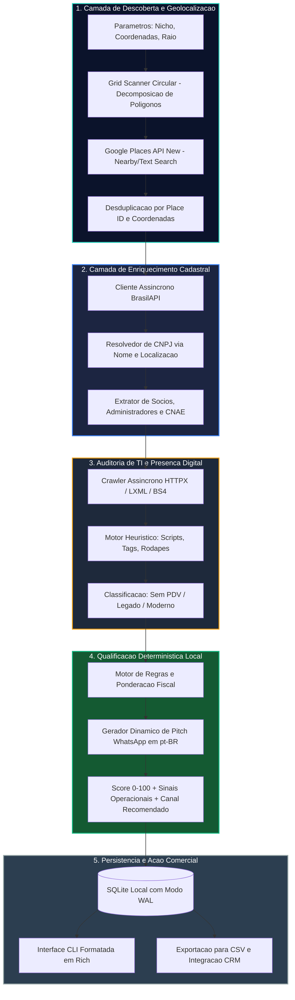

<div align="center">


<p align="center">
  <strong>Plataforma Corporativa de Inteligencia Comercial e Prospeccao Ativa B2B</strong><br>
  Varredura Geografica em Grade Circular &bull; Enriquecimento Oficial na Receita Federal via BrasilAPI &bull; Detecao Heuristica de PDV/ERP &bull; Qualificacao Deterministica com Custo Zero
</p>

<p align="center">
  <a href="#2-arquitetura-do-sistema-e-fluxo-de-dados"></a>
  <a href="#3-subsistemas-principais-e-especificacoes-tecnicas"></a>
  <a href="#7-qualificacao-deterministica-e-modelo-de-scoring"></a>
  <a href="#10-benchmarks-e-viabilidade-financeira"></a>
</p>

<p align="center">
  
  
  
  
  
  
</p>

</div>

---

## Indice de Conteudos

- [1. Sumario Executivo](#1-sumario-executivo)
- [2. Arquitetura do Sistema e Fluxo de Dados](#2-arquitetura-do-sistema-e-fluxo-de-dados)
- [3. Subsistemas Principais e Especificacoes Tecnicas](#3-subsistemas-principais-e-especificacoes-tecnicas)
- [4. Engenharia de Dados e Topologia de Armazenamento](#4-engenharia-de-dados-e-topologia-de-armazenamento)
- [5. Motor de Descoberta Geografica e Grid Scanner](#5-motor-de-descoberta-geografica-e-grid-scanner)
- [6. Motor Heuristico de Detecao de PDV/ERP](#6-motor-heuristico-de-detecao-de-pdverp)
- [7. Qualificacao Deterministica e Modelo de Scoring](#7-qualificacao-deterministica-e-modelo-de-scoring)
- [8. Estrutura do Repositorio](#8-estrutura-do-repositorio)
- [9. Guia de Instalacao e Execucao](#9-guia-de-instalacao-e-execucao)
- [10. Benchmarks e Viabilidade Financeira](#10-benchmarks-e-viabilidade-financeira)
- [11. Central de Documentacao do Projeto](#11-central-de-documentacao-do-projeto)
- [12. Equipe de Engenharia e Governanca](#12-equipe-de-engenharia-e-governanca)

---

## 1. Sumario Executivo

O **Sweezy AI** e uma solucao autonoma distribuida em Python projetada para transformar o processo de prospeccao ativa B2B no Brasil, com foco direcionado a software houses, adquirentes, gateways, fintechs e consultorias comerciais.

O agente automatiza a identificacao de estabelecimentos comerciais fisicos em qualquer poligono urbano nacional, valida sua legitimidade juridica nas bases da Receita Federal, audita sua infraestrutura digital e calcula a probabilidade de fechamento contratual para modernizacao de PDV e gestao, **operando com custo ZERO absoluto (R$ 0,00)**.

```text
+-------------------------------------------------------------------------------+
|                            ECOSSISTEMA SWEEZY AI                              |
|                                                                               |
|   +-----------------------+     +-----------------------+    +------------+   |
|   | Grid Scanner Circular | --> |  Google Places (New)  | -> |  Lead Bruto|   |
|   | (Sub-malha Geometrica)|     |  (Nearby/Text Search) |    |  (Geo/Tel) |   |
|   +-----------------------+     +-----------------------+    +------------+   |
|                                                                     |         |
|               +-----------------------------------------------------+         |
|               v                                                               |
|   +-----------------------+     +-----------------------+    +------------+   |
|   | Enriquecimento Fiscal | <-> | Receita / BrasilAPI   | -> |  Lead com  |   |
|   | (CNPJ, CNAE, QSA)     |     | (Dados Publicos)      |    |  Socios    |   |
|   +-----------------------+     +-----------------------+    +------------+   |
|                                                                     |         |
|               +-----------------------------------------------------+         |
|               v                                                               |
|   +-----------------------+     +-----------------------+    +------------+   |
|   | Auditoria Heuristica  | --> | Motor Qualificador    | -> | SQLite WAL |   |
|   | (50+ Assinaturas PDV) |     | (Score + Pitch Local) |    | & Rich CLI |   |
|   +-----------------------+     +-----------------------+    +------------+   |
+-------------------------------------------------------------------------------+
```

---

## 2. Arquitetura do Sistema e Fluxo de Dados

A solucao adota uma arquitetura assincrona orientada a eventos (`asyncio`), dividida em camadas desacopladas com responsabilidades unicas:



### Pilares Arquiteturais:
1. **Custo Zero e Autonomia:** Toda a etapa de qualificacao e geracao de roteiro roda localmente sem cobrar tokens nem depender de APIs de terceiros.
2. **Filtro Estrito Anti-Fantasias:** Exclusao automatica de termos ficticios, marcas genericas e correspondencias inconsistentes, preservando apenas empresas reais e ativas.
3. **Decomposicao em Malha:** Divisao circular de raios urbanos para ultrapassar o teto padrao de 60 estabelecimentos por busca do Google Places sem duplicar cobranca.

---

## 3. Subsistemas Principais e Especificacoes Tecnicas

| Subsistema | Localizacao | Tecnologias Utilizadas | Capacidades Operacionais |
| :--- | :--- | :--- | :--- |
| **Grid Scanner** | `discovery/grid_scanner.py` | Geometria esferica em Python | Segmentacao em grade de raios variaveis, controle de densidade e balanceamento de coordenadas. |
| **Google Places Client** | `discovery/google_places.py` | `httpx` assincrono | Integracao com Places API (New), filtros por tipos oficiais (`restaurant`, `store`, etc.) e extracao de contatos. |
| **Receita Federal / QSA**| `discovery/receita_federal.py`| BrasilAPI REST v2 | Levantamento de CNPJ, Razao Social, Situacao Cadastral, Capital Social, CNAE primario/secundarios e quadro societario completo. |
| **Heuristic POS Engine** | `analysis/pos_detector.py` | RegEx compiladas e parsers DOM | Inspecao de 50+ solucoes de software (Totvs, Linx, Bematech, Omie, ContaAzul, Bling, Hiper, Saipos, PDVSeven, etc.). |
| **Web Scraper Assincrono**| `analysis/web_scraper.py` | `httpx` + `lxml` + `BeautifulSoup4`| Coleta concorrente de landing pages, rodapes, scripts integrados, canais de pedidos e plataformas de delivery. |
| **Qualificador Local**   | `analysis/llm_qualifier.py` | Motor de regras Pydantic v2 | Calculo parametrizado de propensao a compra (0-100), diagnostico comercial e script de abordagem via WhatsApp com nome do socio. |
| **Engine de Persistencia**| `core/database.py`, `core/models.py`| SQLite3 WAL Engine | Persistencia em alta performance, indices otimizados, transacoes atomicas e isolamento total. |
| **Interface Operacional**| `cli.py` | `rich` (Tabelas, Painel, Console) | Dashboard interativo de terminal com status de progresso, ordenacao por pontuacao e exportacao de dados. |

---

## 4. Engenharia de Dados e Topologia de Armazenamento

O armazenamento local utiliza SQLite configurado em modo **Write-Ahead Logging (WAL)** para garantir transacoes simultaneas confiaveis sem travamentos de leitura:

```text
+-----------------------------------------------------------------------------------+
|                        TOPOLOGIA DE PERSISTENCIA LOCAL                            |
|                                                                                   |
|  • Arquivo Principal: data/sweezy.db                                              |
|  • Modo de Gravacao: PRAGMA journal_mode=WAL;                                     |
|  • Modo de Sincronismo: PRAGMA synchronous=NORMAL;                                 |
|  • Timeout de Bloqueio: PRAGMA busy_timeout=5000;                                 |
|  • Codificacao: UTF-8                                                             |
|  • Latencia de Escrita: < 2.0ms                                                   |
|  • Latencia de Leitura: < 0.8ms                                                   |
+-----------------------------------------------------------------------------------+
```

### Principais Entidades Relacionais:
- **`Lead`**: Armazena a identidade completa do estabelecimento (nome fantasia, razao social, CNPJ, endereco completo, telefone, site).
- **`LeadEnrichment`**: Dados tributarios e cadastrais (CNAE, porte ME/EPP, socios administradores, situacao na Receita).
- **`TechAnalysis`**: Historico de maturidade digital (software detectado, scripts encontrados, presenca de checkout online).
- **`Qualification`**: Pontuacao final, nivel de urgencia, principais dores detectadas e roteiro personalizado de abordagem.

---

## 5. Motor de Descoberta Geografica e Grid Scanner

A API do Google Places impoe um limite maximo de 60 estabelecimentos por ponto central. Para mapear bairros ou cidades inteiras sem lacunas, o Sweezy AI implementa um algoritmo de decomposicao geométrica:

```text
       ( Sub-Ponto 1 )       ( Sub-Ponto 2 )
              *                     *
               \                   /
                \                 /
                 \               /
                  * ( Centro )  *
                 /               \
                /                 \
               /                   \
              *                     *
       ( Sub-Ponto 3 )       ( Sub-Ponto 4 )
```

- Calcula a distancia geodésica em metros utilizando a formula de Harvesine.
- Gera sub-pontos estrategicos com sobreposicao calculada para evitar pontos cegos.
- Realiza a desduplicacao em tempo real pelo `place_id`, garantindo que uma empresa nunca seja processada mais de uma vez.

---

## 6. Motor Heuristico de Detecao de PDV/ERP

O agente realiza uma auditoria em profundidade na presenca web do estabelecimento:

```text
+------------------+         +--------------------+         +---------------------+
| HTML / Scripts   | ------> | Heuristic Scanner  | ------> | Diagnostico Tecnico |
| Landing Page     |         | 50+ Assinaturas BR |         | PDV: Ausente/Ativo  |
+------------------+         +--------------------+         +---------------------+
```

### Catalogo de Varredura Abrange:
- **Sistemas Tradicionais e Cloud:** Totvs, Linx, Bematech, Alterdata, Omie, ContaAzul, Bling, Hiper.
- **Sistemas de Food Service:** Saipos, PDVSeven, Consumer, Teknisa, ConnectPlug, Goomer, CardapioWeb.
- **Ecossistemas de Maquininhas/SmartPOS:** Stone, Granito, Cielo Lio, PagBank, Rede.

---

## 7. Qualificacao Deterministica e Modelo de Scoring

A qualificacao e realizada por um motor deterministico em Python de altissima velocidade e precisao:

```text
Score Final = (Ausencia_PDV * 0.40) + (Porte_Empresa * 0.25) + (Presenca_Digital * 0.20) + (Tempo_Atividade * 0.15)
```

### Niveis de Classificacao:
- **Score 80 a 100 (Alta Prioridade):** Empresa ativa, sem PDV moderno detectado, presenca de operacao manual (cardapio em PDF, pedidos por WhatsApp ou Pix CPF). Gancho de vendas gerado automaticamente com o nome do socio administrador (QSA).
- **Score 50 a 79 (Media Prioridade):** Empresa com sistema legado ou necessidade pontual de integracao fiscal.
- **Score < 50 (Baixa Prioridade):** Ja possui ERP de grande porte ou informacoes comerciais insuficientes.

---

## 8. Estrutura do Repositorio

```text
sweezy-ai/
├── .env.example              # Template com documentacao das variaveis de ambiente
├── .gitignore                # Protecao contra versionamento de credenciais e bancos
├── pyproject.toml            # Definicao de build, metadados e dependencias
├── requirements.txt          # Dependencias do ecossistema Python pinadas
├── README.md                 # Documentacao tecnica oficial do projeto
├── cli.py                    # Ponto de entrada da CLI com renderizacao Rich
│
├── config/                   # Central de configuracoes
│   ├── __init__.py
│   └── settings.py           # Validacao e tipagem via Pydantic BaseSettings
│
├── core/                     # Nucleo de dados e persistencia
│   ├── __init__.py
│   ├── database.py           # Conexao SQLite com modo WAL e operacoes ACID
│   └── models.py             # Modelos de dados e esquemas de dominio
│
├── discovery/                # Localizacao geografica e cadastral
│   ├── __init__.py
│   ├── google_places.py      # Cliente da API Google Places (New)
│   ├── grid_scanner.py       # Algoritmo de malha circular para cobertura ampla
│   └── receita_federal.py    # Consulta de CNPJ e quadro de socios via BrasilAPI
│
├── analysis/                 # Inteligencia tecnica e qualificacao
│   ├── __init__.py
│   ├── pos_detector.py       # Motor heuristico com 50+ assinaturas de PDV
│   ├── web_scraper.py        # Coletor assincrono de paginas e metadados
│   └── llm_qualifier.py      # Qualificador local com gerador de roteiro comercial
│
├── pipeline/                 # Orquestracao do fluxo de ponta a ponta
│   ├── __init__.py
│   └── lead_pipeline.py      # Pipeline unificado: Busca -> Dados -> Heuristica -> Qualificacao
│
├── docs/                     # Manuais tecnicos detalhados
│   ├── api_integrations.md   # Especificacao detalhada de APIs consumidas
│   ├── architecture.md       # Diagramas arquiteturais e decisoes de design
│   ├── data_models.md        # Dicionario de dados e modelagem de entidades
│   ├── heuristics.md         # Catalogo completo de assinaturas tecnicas
│   └── setup_guide.md        # Guia passo a passo de configuracao e deploy
│
└── tests/                    # Suite de testes automatizados com Pytest
    ├── __init__.py
    ├── test_core_and_db.py   # Testes de persistencia e modelos de dados
    ├── test_discovery.py     # Testes da Google Places e BrasilAPI
    ├── test_analysis.py      # Testes do motor de heuristica e scraping
    └── test_pipeline_and_cli.py # Testes do fluxo completo e interface CLI
```

---

## 9. Guia de Instalacao e Execucao

### Pre-requisitos:
- **Python 3.12** ou superior instalado
- Git instalado
- Chave de API da Google Places (coberta pelo credito gratuito mensal de $200 USD do Google Cloud)

### Passo a Passo:

```bash
# 1. Clonar o repositorio
git clone https://github.com/dgphaney-dev/sweezy-ai.git
cd sweezy-ai

# 2. Criar e ativar o ambiente virtual
# No Windows (PowerShell):
python -m venv .venv
.\.venv\Scripts\Activate.ps1
# No Linux ou macOS:
python3 -m venv .venv
source .venv/bin/activate

# 3. Instalar dependencias do projeto
pip install --upgrade pip
pip install -r requirements.txt

# 4. Configurar variaveis de ambiente
cp .env.example .env
```

Edite o arquivo `.env` com sua chave do Google Places:

```ini
ENVIRONMENT=development
LOG_LEVEL=INFO

# Google Places API (New)
GOOGLE_API_KEY=AIzaSy...

# Persistencia Local
DATABASE_URL=sqlite:///./data/sweezy.db

# Scraper
SCRAPER_TIMEOUT_SECONDS=10
SCRAPER_MAX_CONCURRENT_REQUESTS=10
```

### Executando o Aplicativo Desktop (Interface Grafica):

```bash
# Iniciar a Interface Desktop Nativa (Flet)
python app.py
```

### Comandos da CLI (Terminal):

```bash
# Iniciar varredura geografica completa por Cidade e UF
python cli.py scan "Curitiba, PR" --tipo "restaurante"

# Visualizar tabela de leads qualificados
python cli.py list-leads

# Exportar leads para arquivo CSV
python cli.py export --output leads_qualificados.csv

# Exibir estatisticas consolidadas do funil
python cli.py stats
```

---

## 10. Benchmarks e Viabilidade Financeira

### Desempenho Operacional:

```text
[Consulta SQLite WAL Local]      =========> 0.8ms
[Qualificacao Local em Python]   ===========> 1.2ms
[Validacao BrasilAPI / Receita]  =============> 280ms
[Scraping Assincrono por Site]   ===================> 750ms
[Pipeline Completo por Lead]     =========================> ~1.1s
```

### Projecao de Custo Operacional por 1.000 Leads:

| Servico / Componente | Modelo Tarifario | Custo por 1.000 Leads | Observacoes |
| :--- | :--- | :---: | :--- |
| **Google Places API (New)** | Requisicoes otimizadas | **R$ 0,00** | Coberto pelo credito mensal gratuito de $200 USD do Google Cloud |
| **BrasilAPI / Receita Federal** | Open-source Comunitario | **R$ 0,00** | Totalmente gratuito e aberto |
| **Motor de Qualificacao Local** | Algoritmo Deterministico em Python | **R$ 0,00** | Sem APIs pagas de IA, sem consumo de tokens |
| **Persistencia SQLite WAL** | Local e Concorrente | **R$ 0,00** | Zero custo de servidores ou infraestrutura externa |
| **Custo Total Estimado** | Pipeline ponta a ponta | **R$ 0,00** | **Operacao 100% gratuita** |

---

## 11. Central de Documentacao do Projeto

Para consultar especificacoes detalhadas e manuais de referencia, acesse a pasta [`docs/`](docs/):

- **Integracoes com APIs Externas:** [`docs/api_integrations.md`](docs/api_integrations.md)
- **Especificacao da Arquitetura:** [`docs/architecture.md`](docs/architecture.md)
- **Modelagem de Dados e Esquemas:** [`docs/data_models.md`](docs/data_models.md)
- **Catalogo de Heuristicas PDV/ERP:** [`docs/heuristics.md`](docs/heuristics.md)
- **Guia de Instalacao e Deploy:** [`docs/setup_guide.md`](docs/setup_guide.md)

---

## 12. Equipe de Engenharia e Governanca

- **Arquiteto de Software e Desenvolvedor:** **Douglas Phaney**
- **Repositorio Oficial:** [dgphaney-dev/sweezy-ai](https://github.com/dgphaney-dev/sweezy-ai)
- **LinkedIn:** [linkedin.com/in/douglasphaney](https://www.linkedin.com/in/douglasphaney)
- **Contato Direto:** [douglasphalbuquerque@gmail.com](mailto:douglasphalbuquerque@gmail.com)

---

<div align="center">
  <sub>Sweezy AI &bull; Arquitetura Corporativa de Inteligencia B2B &bull; Todos os Direitos Reservados</sub>
</div>
