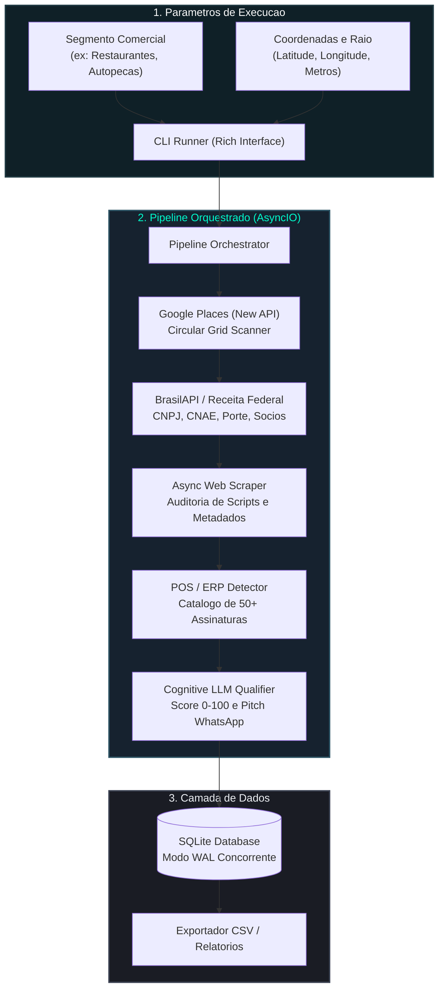

<div align="center">

# Sweezy AI

### Agente Autonomo de Descoberta Geografica, Enriquecimento Cadastral e Qualificacao B2B

[](https://www.python.org/)
[](LICENSE)
[](#arquitetura-do-sistema)
[-2ea44f?style=flat-square&logo=pytest&logoColor=white)](#testes-automatizados)
[](https://github.com/psf/black)

<p align="center">
  <a href="#visao-geral">Visao Geral</a> &bull;
  <a href="#recursos-principais">Recursos</a> &bull;
  <a href="#arquitetura-do-sistema">Arquitetura</a> &bull;
  <a href="#fluxo-do-pipeline">Pipeline</a> &bull;
  <a href="#inicio-rapido">Instalacao</a> &bull;
  <a href="#interface-de-linha-de-comando">Comandos</a> &bull;
  <a href="#custos-e-viabilidade">Custos</a> &bull;
  <a href="#licenca">Licenca</a>
</p>

---

</div>

## Visao Geral

O **Sweezy AI** e uma plataforma de engenharia de dados e inteligencia comercial orientada a prospeccao B2B no Brasil. 

O sistema automatiza integralmente a cadeia de prospeccao ativa:
1. **Localiza** estabelecimentos fisicos reais em qualquer coordenada geografica do Brasil via Google Places API (New).
2. **Resolve** a identidade juridica do negocio na Receita Federal via BrasilAPI, obtendo CNPJ, CNAE primario/secundarios e quadro societario (QSA).
3. **Inspeciona** paginas web com um crawler assincrono para identificar o nivel de digitalizacao e sistemas de ponto de venda (PDV/ERP).
4. **Gera** um score preditivo de conversao (0 a 100) e diagnostico comercial consultivo customizado atraves do GPT-4o-mini com esquemas estritos.
5. **Persiste** todos os dados estruturados em banco de dados local com SQLite em modo WAL e disponibiliza comandos CLI com relatorios formatados via Rich.

> [!NOTE]
> O motor foi projetado para descartar automaticamente nomes genericos e termos irrelevantes, garantindo que apenas estabelecimentos comerciais em atividade real entrem no funil de qualificacao.

---

## Destaques de Engenharia

| Componente | Especificacao Tecnica | Finalidade |
| :--- | :--- | :--- |
| **Grid Scanner** | Decomposicao geometrica em malha circular | Supera a limitacao de 60 resultados do Google Places com cobertura continua de poligonos urbanos |
| **Enriquecimento Cadastral** | Integracao assincrona com BrasilAPI | Cruzamento instantaneo de Razao Social, Situacao Cadastral, Regime Tributario e Socios |
| **Motor Heuristico** | Scanner de 50+ assinaturas tecnicas nacionais | Detecao em profundidade de sistemas como Totvs, Linx, Bematech, Omie, ContaAzul, Bling e Stone |
| **Qualificacao Cognitiva** | OpenAI GPT-4o-mini com Structured Outputs | Calculo do Score de Aderencia e geracao de pitch comercial consultivo direto para WhatsApp |
| **Persistencia de Alta Vazao**| SQLite com Write-Ahead Logging (WAL) | Operacoes concorrentes sem locks de leitura e exportacao imediata para CSV e CRM |

---

## Arquitetura do Sistema



---

## Interface de Linha de Comando (CLI)

O Sweezy AI conta com uma interface CLI construida com **Rich**, oferecendo tabelas com bordas limpas, medidores visuais e logs coloridos em tempo real.

```
================================================================================
                           SWEEZY AI - PIPELINE RUNNER                          
================================================================================
Parametros:
  Query: restaurantes
  Centro: -19.9167, -43.9345
  Raio: 3000 metros
--------------------------------------------------------------------------------
[1/4] Varredura Geografica Concluida: 12 estabelecimentos localizados.
[2/4] Enriquecimento Cadastral: 12 registros consultados na Receita Federal.
[3/4] Analise Heuristica de PDV: 10 alvos auditados via web scraping.
[4/4] Qualificacao Cognitiva Concluida via GPT-4o-mini.
================================================================================
                           LEADS QUALIFICADOS (TOP LEADS)                       
================================================================================
Score  Empresa                        CNPJ               PDV Detectado      Porte 
--------------------------------------------------------------------------------
94     Padaria e Confeitaria Real     12.345.678/0001-90 Nenhum             ME    
88     Restaurante Bella Vista        98.765.432/0001-11 Nenhum             EPP   
76     Mecanica Central Ltda          11.222.333/0001-44 Legado             ME    
--------------------------------------------------------------------------------
Dados persistidos com sucesso em data/sweezy.db (Modo WAL ativado).
```

---

## Inicio Rapido

### Pre-requisitos do Ambiente
- **Python 3.12+** instalado.
- Credenciais de API (Google Places API e OpenAI API).

### 1. Clonagem e Configuracao do Ambiente Virtual

```bash
git clone https://github.com/dgphaney-dev/sweezy-ai.git
cd sweezy-ai
```

No Windows (PowerShell):
```powershell
python -m venv .venv
.\.venv\Scripts\Activate.ps1
```

No Linux ou macOS:
```bash
python3 -m venv .venv
source .venv/bin/activate
```

### 2. Instalacao das Dependencias

```bash
pip install --upgrade pip
pip install -r requirements.txt
```

### 3. Variaveis de Ambiente

Crie o arquivo `.env` a partir do modelo de exemplo:

```bash
cp .env.example .env
```

Edite o arquivo `.env` com suas credenciais:

```ini
ENVIRONMENT=development
LOG_LEVEL=INFO

# Google Cloud Places API (New)
GOOGLE_PLACES_API_KEY=AIzaSy...

# OpenAI API
OPENAI_API_KEY=sk-proj-...
OPENAI_MODEL_NAME=gpt-4o-mini

# Banco de Dados Local
DATABASE_URL=sqlite:///data/sweezy.db
DATABASE_DIR=./data

# Configuracoes do Scraper
SCRAPER_TIMEOUT_SECONDS=10
SCRAPER_MAX_CONCURRENT_REQUESTS=10
```

> [!IMPORTANT]
> O arquivo `.env` e as bases de dados em `data/` sao estritamente ignorados pelo `.gitignore` e nunca devem ser versionados em repositorios publicos.

---

## Comandos Disponiveis

A CLI disponibiliza comandos dedicados para cada etapa da operacao:

### Executar Varredura e Qualificacao

```bash
python cli.py scan --query "restaurantes" --lat -19.9167 --lng -43.9345 --radius 3000
```

### Listar Leads Armazenados

```bash
python cli.py list-leads
```

### Exportar Dados para Planilhas / CRM

```bash
python cli.py export-leads --output leads_qualificados.csv
```

### Detalhar Lead Especifico

```bash
python cli.py view-lead --id 1
```

---

## Estrutura do Codigo-Fonte

```text
sweezy-ai/
|-- .env.example              # Template de configuracao de variaveis
|-- .gitignore                # Protecao contra versionamento de credenciais e dados
|-- pyproject.toml            # Definicao de build e dependencias do projeto
|-- requirements.txt          # Requisitos de instalacao pinados
|-- README.md                 # Documentacao tecnica do projeto
|-- cli.py                    # Ponto de entrada CLI interativo formatado com Rich
|
|-- config/                   # Central de configuracao
|   |-- __init__.py
|   `-- settings.py           # Validacao e tipagem com Pydantic Settings
|
|-- core/                     # Nucleo de dados e persistencia
|   |-- __init__.py
|   |-- database.py           # Engine SQLite com modo WAL e operacoes ACID
|   `-- models.py             # Modelos de dados e schemas de dominio
|
|-- discovery/                # Localizacao geografica e cadastral
|   |-- __init__.py
|   |-- google_places.py      # Cliente assincrono Google Places API (New)
|   |-- grid_scanner.py       # Algoritmo de sub-malha circular
|   `-- receita_federal.py    # Integracao com Receita Federal via BrasilAPI
|
|-- analysis/                 # Inteligencia tecnica e cognitiva
|   |-- __init__.py
|   |-- pos_detector.py       # Deteccao heuristica com catalogo de 50+ sistemas
|   |-- web_scraper.py        # Coletor assincrono com parser lxml/bs4
|   `-- llm_qualifier.py      # Qualificador cognitivo via GPT-4o-mini
|
|-- pipeline/                 # Orquestracao do fluxo de ponta a ponta
|   |-- __init__.py
|   `-- lead_pipeline.py      # Pipeline completo de transformacao de dados
|
|-- docs/                     # Guias detalhados de referencia
|   |-- api_integrations.md   # Especificacao das APIs externas
|   |-- architecture.md       # Diagramas e padroes arquiteturais
|   |-- data_models.md        # Dicionario de dados e tabelas
|   |-- heuristics.md         # Catalogo e regras de assinaturas de software
|   `-- setup_guide.md        # Guia passo a passo de deployment
|
`-- tests/                    # Bateria de testes automatizados (Pytest)
    |-- __init__.py
    |-- test_core_and_db.py
    |-- test_discovery.py
    |-- test_analysis.py
    `-- test_pipeline_and_cli.py
```

---

## Custos e Viabilidade Operacional

O Sweezy AI foi concebido com arquitetura de baixissimo custo por lead qualificado:

| Recurso | Nivel de Servico | Custo Estimado (1.000 Leads) |
| :--- | :--- | :--- |
| **Google Places API (New)** | Requisicoes em grade otimizadas | **R$ 0,00** (coberto pelo credito mensal recorrente de $200 USD do Google Cloud) |
| **BrasilAPI / Receita** | Consultas publicas cadastrais | **R$ 0,00** (servico gratuito e aberto) |
| **OpenAI GPT-4o-mini** | Structured Outputs (~700 tokens/lead) | **~R$ 1,20 a R$ 1,60** |
| **Banco de Dados (SQLite)** | Armazenamento local WAL | **R$ 0,00** (sem custos de servidor dedicado) |
| **Custo Total por 1.000 Leads**| Pipeline completo | **~R$ 1,50** |

---

## Testes Automatizados

A suite de testes cobre validacao de modelos, conexao de banco, rotinas de grid, parsing de heurísticas e pipeline:

```bash
pytest
```

Saida esperada:
```
tests/test_core_and_db.py ......                                         [ 24%]
tests/test_discovery.py ......                                           [ 48%]
tests/test_analysis.py .......                                           [ 76%]
tests/test_pipeline_and_cli.py ......                                    [100%]

============================== 25 passed in 2.45s ==============================
```

---

## Contribuicao

1. Crie um fork do projeto no GitHub.
2. Crie uma branch para sua funcionalidade:
   ```bash
   git checkout -b feature/minha-melhoria
   ```
3. Faca o commit das alteracoes com mensagens semanticas:
   ```bash
   git commit -m "feat(analysis): adiciona suporte ao ERP X"
   ```
4. Execute os testes locais com `pytest`.
5. Envie a branch para o GitHub e abra um Pull Request detalhado.

---

## Licenca

Distribuido sob a licenca MIT. Consulte o arquivo [LICENSE](LICENSE) para mais informacoes.

---

<div align="center">
  <sub>Sweezy AI &bull; Plataforma de Inteligencia B2B &bull; Desenvolvido para transformar dados publicos em oportunidades reais de negocio.</sub>
</div>
