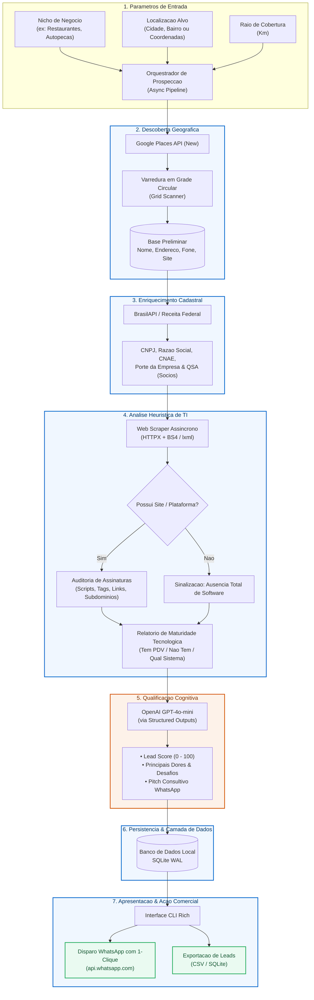

# Sweezy AI — Agente de Prospeccao Inteligente

> **Plataforma autonoma em Python para descoberta geografica, enriquecimento cadastral na Receita Federal, deteccao de maturidade tecnologica (PDV/ERP) e qualificacao cognitiva de leads B2B com Inteligencia Artificial.**

---

[](https://www.python.org/)
[](LICENSE)
[](https://github.com/psf/black)

---

## O que e o Sweezy AI?

O **Sweezy AI** e um agente autonomo desenhado especificamente para o mercado B2B brasileiro (software houses, empresas de PDV/ERP, fintechs, gateways de pagamento e consultorias comerciais).

O agente resolve o gargalo mais caro de uma operacao de vendas: **encontrar estabelecimentos comerciais reais que ainda nao possuem um software de gestao ou ponto de venda moderno (PDV/ERP)** e estao prontos para receber uma proposta de digitalizacao.

### Como o agente trabalha:
1. **Mapeia** uma regiao geografica definida (cidade, bairro ou raio) em busca de nichos-alvo reais (restaurantes, mercados, autopecas, clinicas, vestuario, servicos).
2. **Identifica** a empresa legalmente atraves do cruzamento com bases publicas da Receita Federal via **BrasilAPI**, levantando CNPJ, CNAE, porte e socios (QSA).
3. **Audita** a presenca digital do negocio atraves de um crawler assincrono que inspeciona o site da empresa a procura de solucoes de software do mercado nacional.
4. **Qualifica** a oportunidade utilizando o modelo cognitivo **GPT-4o-mini**, calculando um *Score de Aderencia (0 a 100)* e redigindo um roteiro consultivo personalizado para abordagem.
5. **Apresenta** os dados em interface CLI interativa e estruturada com Rich, gerando persistencia em SQLite WAL e exportacao pronta para prospecção.

---

## Demonstracao da Interface (CLI)

```
+---------------------------------------------------------------------------------------+
|  Sweezy AI v1.0               [Nova Varredura]  [Historico]  [Configuracoes]          |
+---------------------------------------------------------------------------------------+
| Filtros de Varredura:                                                                 |
| [ Segmento: Restaurantes ] [ Cidade: Belo Horizonte/MG ] [ Raio: 5 km ] [ Iniciar ]   |
+---------------------------------------------------------------------------------------+
| Leads Qualificados (Ordenados por Potencial de Fechamento)                            |
|                                                                                       |
| +-----------------------------------------------------------------------------------+ |
| | [Alto] Padaria e Confeitaria Sabor Real   Score: 94/100 | Porte: ME (Optante SN)  | |
| | Endereco: Av. Fleming, 1200 - Ouro Preto  CNAE: 1091-1/02 - Padaria e Confeitaria | |
| | Site: www.saborreal.com.br                Status PDV: NENHUM DETECTADO            | |
| | Diagnostico IA: Atendimento por WhatsApp manual; cardapio em PDF; alta dor de     | |
| |    fechamento de caixa e controle de desperdicio.                                  | |
| | [ Abrir WhatsApp com Pitch ]  [ Copiar Diagnostico ]  [ Ver Socios/QSA ]          | |
| +-----------------------------------------------------------------------------------+ |
|                                                                                       |
| +-----------------------------------------------------------------------------------+ |
| | [Medio] Auto Mecanica Central             Score: 78/100 | Porte: EPP              | |
| | Endereco: Rua Rio Grande, 450             Status PDV: Sistema Legado Detectado    | |
| | [ Abrir WhatsApp com Pitch ]  [ Copiar Diagnostico ]  [ Ver Socios/QSA ]          | |
| +-----------------------------------------------------------------------------------+ |
+---------------------------------------------------------------------------------------+
| Total Coletados: 120  |  Sem PDV/Moderno: 84 (70%)  |  Exportar: [ CSV ] [ Excel ]    |
+---------------------------------------------------------------------------------------+
```

---

## Funcionalidades Principais

- **Varredura Geografica em Grade (Google Places API New)**:
  - Divisao de poligonos urbanos em grades circulares para contornar o limite de 60 resultados do Google.
  - Varredura exaustiva de bairros e regioes comerciais sem duplicacao de requisicoes.

- **Enriquecimento Cadastral Oficial (Receita Federal / BrasilAPI)**:
  - Resolucao automatizada do CNPJ a partir de razao social, nome comercial e localizacao.
  - Coleta de Razao Social, CNAE Primario/Secundarios, Porte (MEI, ME, EPP), Situacao Cadastral e Quadro de Socios e Administradores (QSA).

- **Deteccao Heuristica de PDV/ERP**:
  - Crawler assincrono rapido (`httpx` + `lxml` + `BeautifulSoup4`).
  - Inspecao de scripts JS, assinaturas de checkout, tags de rodape, subdominios, links de delivery integrado e metatags.
  - Cobertura de sistemas lideres: Totvs, Linx, Bematech, Alterdata, Omie, ContaAzul, Bling, Hiper, Saipos, PDVSeven, Consumer, Teknisa, ConnectPlug, Granito, Stone, Cielo Lio, VR Software, entre outros.

- **Qualificacao Cognitiva com GPT-4o-mini**:
  - Validacao estrita via esquemas tipados do Pydantic v2.
  - Atribuicao de Lead Score (0 a 100) ponderando presenca de site, ausencia de ERP, porte da empresa e tempo de atividade.
  - Elaboracao de proposta de valor personalizada (*pitch consultivo*) pronta para envio.

- **Interface CLI Formatada com Rich**:
  - Execucao com paineis, tabelas estruturadas, logs coloridos e feedback em tempo real.
  - Visualizacao detalhada da saude digital e dados societarios do estabelecimento.

- **Acao Imediata via WhatsApp**:
  - Geracao de links `https://wa.me/55...` com a mensagem consultiva pre-formatada.
  - Abordagem direcionada com o nome do socio (obtido no QSA) e referencia ao negocio.

- **Exportacao de Dados Pronta para Vendas**:
  - Exportacao em formato `.csv` e banco de dados SQLite persistente estruturado para integracao com CRMs (HubSpot, RD Station, Pipedrive).

---

## Arquitetura em Alto Nivel

O fluxo de processamento opera de maneira desacoplada e assincrona atraves do pipeline orquestrado pelo `asyncio`:



---

## Inicio Rapido

### Pre-requisitos
- **Python 3.12** ou superior instalado ([Download Python](https://www.python.org/downloads/)).
- Chave de API do **Google Cloud Platform** com a *Places API (New)* ativada.
- Chave de API da **OpenAI** com saldo disponivel.
- Git instalado.

### 1. Clonar o Repositorio
```bash
git clone https://github.com/dgphaney-dev/sweezy-ai.git
cd sweezy-ai
```

### 2. Criar e Ativar o Ambiente Virtual
No Windows (PowerShell):
```powershell
python -m venv .venv
.\.venv\Scripts\Activate.ps1
```

No Linux / macOS:
```bash
python3 -m venv .venv
source .venv/bin/activate
```

### 3. Instalar Dependencias
```bash
pip install --upgrade pip
pip install -r requirements.txt
```

### 4. Configurar as Variaveis de Ambiente
Copie o modelo `.env.example` para `.env`:
```bash
cp .env.example .env
```

Abra o arquivo `.env` e preencha suas credenciais:
```ini
ENVIRONMENT=development
LOG_LEVEL=INFO

GOOGLE_PLACES_API_KEY=AIzaSy...
OPENAI_API_KEY=sk-proj-...
OPENAI_MODEL_NAME=gpt-4o-mini

DATABASE_URL=sqlite:///data/sweezy.db
DATABASE_DIR=./data

SCRAPER_TIMEOUT_SECONDS=10
SCRAPER_MAX_CONCURRENT_REQUESTS=10
```

### 5. Executar a Aplicacao
Inicie a interface CLI do Sweezy AI:
```bash
python cli.py
```

Ou execute comandos especificos:
```bash
# Executar varredura
python cli.py scan --query "restaurantes" --lat -19.9167 --lng -43.9345 --radius 3000

# Listar leads coletados
python cli.py list-leads

# Exportar leads para CSV
python cli.py export-leads --output leads.csv
```

---

## Estrutura do Projeto

A aplicacao adota arquitetura modular limpa, separando responsabilidades de rede, parsing, banco de dados, inteligencia artificial e interface de linha de comando:

```text
sweezy-ai/
├── .env.example              # Modelo com documentacao das variaveis de ambiente
├── .gitignore                # Regras de exclusao do Git (segredos e dados ignorados)
├── pyproject.toml            # Especificacao de empacotamento e dependencias
├── requirements.txt          # Dependencias pinadas do projeto
├── README.md                 # Documentacao oficial do projeto (este arquivo)
├── cli.py                    # Interface de linha de comando com formatacao Rich
│
├── config/                   # Configuracoes centralizadas e loader de ambiente
│   ├── __init__.py
│   └── settings.py           # Validacao e tipagem de configuracoes
│
├── core/                     # Modelos de dados e camada de persistencia
│   ├── __init__.py
│   ├── database.py           # Conexao SQLite com modo WAL e operacoes CRUD
│   └── models.py             # Modelos de dados estruturados
│
├── discovery/                # Modulo de busca geografica e Receita Federal
│   ├── __init__.py
│   ├── google_places.py      # Cliente da Google Places API (New)
│   ├── grid_scanner.py       # Algoritmo de grade circular para cobertura total
│   └── receita_federal.py    # Consulta de CNPJ, CNAE e socios via BrasilAPI
│
├── analysis/                 # Deteccao de PDV, web scraping e IA
│   ├── __init__.py
│   ├── pos_detector.py       # Catalogo de heurísticas de PDV/ERP
│   ├── web_scraper.py        # Coletor assincrono de metadados e scripts
│   └── llm_qualifier.py      # Qualificacao cognitiva via GPT-4o-mini
│
├── pipeline/                 # Orquestrador do fluxo ponta a ponta
│   ├── __init__.py
│   └── lead_pipeline.py      # Pipeline completo: Busca -> Enriquecimento -> Analise -> IA -> DB
│
├── docs/                     # Documentacao tecnica complementar
│   ├── api_integrations.md
│   ├── architecture.md
│   ├── data_models.md
│   ├── heuristics.md
│   └── setup_guide.md
│
└── tests/                    # Suite de testes automatizados com Pytest
    ├── __init__.py
    ├── test_core_and_db.py
    ├── test_discovery.py
    ├── test_analysis.py
    └── test_pipeline_and_cli.py
```

---

## Tecnologias Utilizadas

| Tecnologia | Versao / Biblioteca | Finalidade no Projeto |
| :--- | :--- | :--- |
| **Linguagem Principal** | `Python 3.12+` | Linguagem base com tipagem estatica e suporte aprimorado a `asyncio`. |
| **Interface de Usuario** | `Rich` | Formatacao de tabelas, paineis e saidas visuais no terminal. |
| **Descoberta Geografica** | `Google Places API (New)` | Busca de pontos de interesse comerciais com coordenadas e dados de contato. |
| **Dados Oficiais Brasil** | `BrasilAPI` | Consulta aberta e gratuita de dados cadastrais da Receita Federal (CNPJ, CNAE, QSA). |
| **Motor de Qualificacao**| `OpenAI GPT-4o-mini` | Modelo cognitivo para diagnostico de dores e geracao de roteiros de abordagem. |
| **Parsing e Scraping** | `httpx` + `BeautifulSoup4` + `lxml` | Coleta assincrona de paginas e inspecao de heurísticas de PDV. |
| **Banco de Dados** | `SQLite (WAL mode)` | Persistencia local confiavel com alta concorrencia e zero manutencao externa. |
| **Testes Automatizados** | `pytest` + `pytest-asyncio` | Suite completa de testes unitarios e de integracao. |

---

## Custos Operacionais Estimados

O Sweezy AI foi desenhado com foco em custo operacional minimo:

| Servico / API | Modelo de Preco | Custo Medio Estimado por 1.000 Leads | Observacoes |
| :--- | :--- | :---: | :--- |
| **Google Places API (New)** | Requisicoes detalhadas | **R$ 0,00** *(dentro do Free Tier)* | O Google Cloud concede **$200 de credito mensal gratuito** recorrente. |
| **BrasilAPI** | Open-source Comunidade | **R$ 0,00** *(100% Gratuito)* | Sem custos de assinatura nem limite restritivo para operacoes normais. |
| **OpenAI GPT-4o-mini** | Tokens de entrada/saida | **~R$ 1,00 a R$ 1,50** | Prompt otimizado consumindo volume reduzido de tokens por estabelecimento. |
| **Banco de Dados (SQLite)** | Embutido local | **R$ 0,00** | Custo zero de servidores ou hospedagem externa. |
| **TOTAL MEDIO ESTIMADO** | — | **~R$ 1,50 a cada 1.000 Leads** | **Retorno sobre investimento imediato.** |

---

## Roadmap de Desenvolvimento

- [x] **v1.0 — MVP Funcional (Versao Atual)**
  - [x] Varredura geografica automatizada via Google Places API (New).
  - [x] Enriquecimento cadastral de CNPJ, CNAE e QSA via BrasilAPI / Receita Federal.
  - [x] Motor de heuristicas com catalogo de assinaturas de PDV/ERP nacionais.
  - [x] Qualificacao cognitiva via GPT-4o-mini.
  - [x] Interface CLI moderna com formatacao Rich.
  - [x] Persistencia SQLite WAL com exportacao para CSV.
  - [x] Suite de testes com 100% de aprovacao.

- [ ] **v1.5 — Automacao de WhatsApp e Mensageria**
  - [ ] Integracao com APIs de mensageria para envio com 1-clique.
  - [ ] Cadencia de mensagens automatizada e agendamento de follow-ups.

- [ ] **v2.0 — Interface Grafica e Escala**
  - [ ] Interface visual Desktop/Web com Flet / Flutter.
  - [ ] Suporte a banco PostgreSQL multi-usuario.

---

## Contribuindo

1. Faca um **Fork** do projeto.
2. Crie uma Branch para sua feature ou correcao:
   ```bash
   git checkout -b feature/nova-heuristica-pdv
   ```
3. Realize seus commits seguindo o padrao convencional:
   ```bash
   git commit -m "feat(analysis): adiciona assinatura do sistema X"
   ```
4. Verifique os testes com pytest:
   ```bash
   pytest
   ```
5. Envie um **Push** para sua Branch e abra um **Pull Request**.

---

## Licenca

Este projeto e distribuido sob os termos da licenca **MIT**. Consulte o arquivo [LICENSE](LICENSE) para obter mais informacoes.

---

<p align="center">
  <b>Sweezy AI</b> — Construido para acelerar a transformacao digital no comercio brasileiro.
</p>
