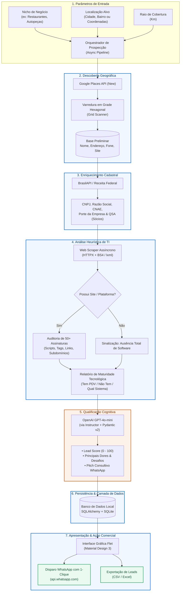

# 🎯 Sweezy AI — Agente de Prospecção Inteligente

> **Plataforma autônoma em Python para descoberta geográfica, enriquecimento cadastral na Receita Federal, detecção de maturidade tecnológica (PDV/ERP) e qualificação cognitiva de leads B2B com Inteligência Artificial.**

---

[](https://www.python.org/)
[](LICENSE)
[](#roadmap)
[-02569B.svg?logo=flutter&logoColor=white)](https://flet.dev/)
[](https://platform.openai.com/)
[](https://github.com/psf/black)

---

## 💡 O que é o Sweezy AI?

O **Sweezy AI** é um agente autônomo desenhado especificamente para o mercado B2B brasileiro (software houses, empresas de PDV/ERP, fintechs, gateways de pagamento e consultorias comerciais). 

O agente resolve o gargalo mais caro de uma operação de vendas: **encontrar estabelecimentos comerciais que ainda não possuem um software de gestão ou ponto de venda moderno (PDV/ERP)** e estão prontos para receber uma proposta de digitalização.

### Como o agente trabalha:
1. **Mapeia** uma região geográfica definida (cidade, bairro ou raio) em busca de nichos-alvo (restaurantes, mercados, autopeças, clínicas, vestuário, serviços).
2. **Identifica** a empresa legalmente através do cruzamento com bases públicas da Receita Federal via **BrasilAPI**, levantando CNPJ, CNAE, porte e sócios.
3. **Audita** a presença digital do negócio através de um crawler assíncrono que inspeciona o site da empresa à procura de mais de 50 soluções de software do mercado nacional.
4. **Qualifica** a oportunidade utilizando o modelo cognitivo **GPT-4o-mini**, calculando um *Score de Aderência (0 a 100)* e redigindo um roteiro consultivo personalizado para abordagem.
5. **Apresenta** os dados em uma interface interativa (Desktop/Mobile) desenvolvida em **Flet**, com disparo imediato de mensagem no WhatsApp do proprietário/decisor.

---

## 📸 Demonstração da Interface (Screenshots)

> [!NOTE]
> As capturas de tela abaixo ilustram a interface gráfica desenvolvida em **Flet (Material Design 3)**, com suporte a temas Claro/Escuro e layout responsivo.

```
+---------------------------------------------------------------------------------------+
|  ProspectAI v1.0               [🔎 Nova Varredura]  [📂 Histórico]  [⚙️ Configurações] |
+---------------------------------------------------------------------------------------+
| Filtros de Varredura:                                                                 |
| [ Segmento: Restaurantes ▼ ] [ Cidade: Belo Horizonte/MG ] [ Raio: 5 km ] [ Iniciar ] |
+---------------------------------------------------------------------------------------+
| 🎯 Leads Qualificados (Ordenados por Potencial de Fechamento)                          |
|                                                                                       |
| +-----------------------------------------------------------------------------------+ |
| | 🟢 Padaria & Confeitaria Sabor Real       Score: 94/100 | Porte: ME (Optante SN)  | |
| | 📍 Av. Fleming, 1200 - Ouro Preto         CNAE: 1091-1/02 - Padaria e Confeitaria | |
| | 🌐 www.saborreal.com.br                   Status PDV: ⚠️ NENHUM DETECTADO         | |
| | 💡 Diagnóstico IA: Atendimento por WhatsApp manual; cardápio em PDF; alta dor de  | |
| |    fechamento de caixa e controle de desperdício.                                   | |
| | [ 💬 Abrir WhatsApp com Pitch ]  [ 📋 Copiar Diagnóstico ]  [ 🏢 Ver Sócios/QSA ] | |
| +-----------------------------------------------------------------------------------+ |
|                                                                                       |
| +-----------------------------------------------------------------------------------+ |
| | 🟡 Auto Mecânica Central                 Score: 78/100 | Porte: EPP               | |
| | 📍 Rua Rio Grande, 450 - Funcionários    Status PDV: ℹ️ Sistema Legado Detectado  | |
| | [ 💬 Abrir WhatsApp com Pitch ]  [ 📋 Copiar Diagnóstico ]  [ 🏢 Ver Sócios/QSA ] | |
| +-----------------------------------------------------------------------------------+ |
+---------------------------------------------------------------------------------------+
| Total Coletados: 120  |  Sem PDV/Moderno: 84 (70%)  |  Exportar: [ CSV ] [ Excel ]    |
+---------------------------------------------------------------------------------------+
```

*(Imagens reais da aplicação estarão disponíveis na pasta `docs/screenshots/` nas próximas versões estáveis).*

---

## ✨ Funcionalidades Principais

- 🛰️ **Varredura Geográfica em Grade (Google Places API New)**:
  - Divisão de polígonos urbanos em grades circulares/hexagonais para contornar o limite de 60 resultados do Google.
  - Varredura exaustiva de bairros e regiões comerciais sem duplicação de requisições.

- 🏢 **Enriquecimento Cadastral Oficial (Receita Federal / BrasilAPI)**:
  - Resolução automatizada do CNPJ a partir do nome fantasia, telefone e localização.
  - Coleta de Razão Social, CNAE Primário/Secundários, Porte (MEI, ME, EPP), Situação Cadastral e Quadro de Sócios e Administradores (QSA).

- 🔍 **Detecção Heurística de PDV/ERP (50+ Plataformas Nacionais)**:
  - Crawler assíncrono ultra-rápido (`httpx` + `lxml` + `BeautifulSoup4`).
  - Inspeção profunda de scripts JS, assinaturas de checkout, tags de rodapé, subdomínios, links de delivery integrado e metatags.
  - Cobertura de sistemas líderes: *Totvs, Linx, Bematech, Alterdata, Omie, ContaAzul, Bling, Hiper, Saipos, PDVSeven, Consumer, Teknisa, ConnectPlug, Granito, Stone, Cielo Lio, VR Software*, entre outros.

- 🧠 **Qualificação Cognitiva com GPT-4o-mini & Instructor**:
  - Validação estrita via esquemas tipados do `Pydantic v2`.
  - Atribuição de Lead Score (0–100) ponderando: presença de site, ausência de ERP, porte da empresa, tempo de atividade e densidade de concorrência.
  - Elaboração de proposta de valor personalizada (*pitch consultivo*) pronta para envio.

- 💻 **Interface Moderna em Flet (Material Design 3)**:
  - Executável tanto como aplicação desktop nativa quanto no navegador ou mobile.
  - Tabela dinâmica de leads com paginação, filtros avançados e busca instantânea.
  - Cartões com visualização rápida da saúde digital do estabelecimento.

- 💬 **Ação Imediata via WhatsApp**:
  - Geração de links `https://wa.me/55...` com a mensagem consultiva pré-formatada.
  - Abordagem direcionada com o nome do sócio (obtido no QSA) e referência ao negócio.

- 📊 **Exportação de Dados Pronta para Vendas**:
  - Exportação em formatos `.csv` e `.xlsx` (Excel), estruturados para importação direta em ferramentas como HubSpot, RD Station, Pipedrive e Notion.

---

## 🏗️ Arquitetura em Alto Nível

O fluxo de processamento opera de maneira totalmente desacoplada e assíncrona através do pipeline orquestrado pelo `asyncio`:



---

## 🚀 Início Rápido

### Pré-requisitos
- **Python 3.12** ou superior instalado ([Download Python](https://www.python.org/downloads/)).
- Chave de API do **Google Cloud Platform** com a *Places API (New)* ativada.
- Chave de API da **OpenAI** com saldo disponível.
- Git instalado.

### 1. Clonar o Repositório
```bash
git clone https://github.com/seu-usuario/prospectai.git
cd prospectai
```

### 2. Criar e Ativar o Ambiente Virtual
No Windows (PowerShell):
```powershell
python -m venv .venv
.\.venv\Scripts\Activate.ps1
```

No Linux / macOS:
```bash
python3 -m venv .venv
source .venv/bin/activate
```

### 3. Instalar Dependências
```bash
pip install --upgrade pip
pip install -r requirements.txt
```

### 4. Configurar as Variáveis de Ambiente
Copie o modelo `.env.example` para `.env`:
```bash
cp .env.example .env
```

Abra o arquivo `.env` e preencha suas credenciais:
```ini
# ==============================================================================
# CONFIGURAÇÃO GERAL - PROSPECTAI
# ==============================================================================
ENVIRONMENT=development
LOG_LEVEL=INFO

# ==============================================================================
# GOOGLE PLACES API (NEW)
# ==============================================================================
# Obtenha sua chave no console do Google Cloud: https://console.cloud.google.com/
GOOGLE_PLACES_API_KEY=AIzaSyD-SUA_CHAVE_AQUI

# ==============================================================================
# OPENAI API
# ==============================================================================
# Obtenha sua chave em: https://platform.openai.com/api-keys
OPENAI_API_KEY=sk-proj-SUA_CHAVE_OPENAI_AQUI
OPENAI_MODEL_NAME=gpt-4o-mini

# ==============================================================================
# BANCO DE DADOS (SQLITE / POSTGRESQL)
# ==============================================================================
DATABASE_URL=sqlite+aiosqlite:///data/prospectai.db

# ==============================================================================
# PARÂMETROS DO CRAWLER E SCRAPING
# ==============================================================================
SCRAPER_TIMEOUT_SECONDS=10
SCRAPER_MAX_CONCURRENT_REQUESTS=15
SCRAPER_USER_AGENT="Mozilla/5.0 (Windows NT 10.0; Win64; x64) AppleWebKit/537.36 (KHTML, like Gecko) Chrome/128.0.0.0 Safari/537.36"
```

### 5. Executar as Migrações do Banco de Dados
```bash
alembic upgrade head
```

### 6. Executar a Aplicação
Inicie a interface gráfica interativa do ProspectAI:
```bash
python -m src.main
# ou diretamente via flet:
flet run src/ui/app.py
```

---

## 📁 Estrutura do Projeto

A aplicação adota arquitetura modular limpa (*Clean Architecture* adaptada), separando responsabilidades de rede, parsing, banco de dados, inteligência artificial e interface de usuário:

```text
agente_ia/
├── .env.example              # Modelo com documentação das variáveis de ambiente
├── .gitignore                # Regras de exclusão do Git
├── alembic.ini               # Configuração do gerenciador de migrações
├── pyproject.toml            # Especificação de empacotamento e ferramentas
├── requirements.txt          # Dependências pinadas do ecossistema Python
├── README.md                 # Documentação oficial do projeto (este arquivo)
│
├── alembic/                  # Histórico e scripts de migração do banco
│   ├── env.py                # Configuração de contexto do SQLAlchemy/Alembic
│   └── versions/             # Scripts versionados de DDL
│
├── data/                     # Dados locais e persistência de arquivos
│   ├── prospectai.db         # Banco de dados SQLite padrão
│   └── exports/              # Diretório padrão para exportações CSV e XLSX
│
├── src/                      # Núcleo da aplicação
│   ├── __init__.py
│   ├── main.py               # Ponto de entrada (CLI e inicialização da UI)
│   │
│   ├── config/               # Gerenciamento de configurações e variáveis de ambiente
│   │   ├── __init__.py
│   │   └── settings.py       # Pydantic BaseSettings para validação do .env
│   │
│   ├── core/                 # Utilitários transversais
│   │   ├── __init__.py
│   │   ├── logger.py         # Formatação de logs estilizados com Rich
│   │   └── retry.py          # Políticas de resiliência e retries com Tenacity
│   │
│   ├── models/               # Modelagem de dados e esquemas
│   │   ├── __init__.py
│   │   ├── domain.py         # Schemas de dados Pydantic v2 (Input/Output da IA)
│   │   └── entities.py       # Entidades ORM do SQLAlchemy
│   │
│   ├── database/             # Camada de persistência
│   │   ├── __init__.py
│   │   ├── session.py        # Criação de conexões e sessões assíncronas
│   │   └── repository.py     # Operações de CRUD de leads e varreduras
│   │
│   ├── pipeline/             # Orquestração do pipeline assíncrono
│   │   ├── __init__.py
│   │   └── orchestrator.py   # Gerencia a execução em fila: Busca -> Enriquecimento -> Scraping -> LLM
│   │
│   ├── discovery/            # Módulo de busca geográfica
│   │   ├── __init__.py
│   │   ├── client.py         # Cliente HTTP assíncrono da Google Places API (New)
│   │   └── grid_scanner.py   # Algoritmo de subdivisão em grade geográfica
│   │
│   ├── enrichment/           # Enriquecimento cadastral público
│   │   ├── __init__.py
│   │   └── brasilapi_client.py # Consulta de CNPJ, CNAE e Sócios na BrasilAPI
│   │
│   ├── scraping/             # Auditoria de sites e heurísticas de software
│   │   ├── __init__.py
│   │   ├── crawler.py        # Coletor HTTP assíncrono de páginas e metadados
│   │   └── heuristics.py     # Catálogo de assinaturas e regras de detecção de 50+ PDVs
│   │
│   ├── qualification/        # Inteligência Artificial e avaliação cognitiva
│   │   ├── __init__.py
│   │   ├── prompt_templates.py # Engenharia de prompts e personas consultivas
│   │   └── qualifier.py      # Integração OpenAI + Instructor com structured outputs
│   │
│   └── ui/                   # Interface gráfica desktop e mobile
│       ├── __init__.py
│       ├── app.py            # Inicialização da aplicação Flet
│       ├── components/       # Componentes visuais reutilizáveis
│       │   ├── lead_card.py  # Card detalhado do lead com ações
│       │   ├── filter_bar.py # Barra superior de filtros e disparos
│       │   └── stats_panel.py# Painel com métricas de conversão da varredura
│       └── views/            # Telas principais
│           ├── dashboard.py  # Visão principal com tabela e cards
│           └── settings_view.py # Painel de chaves de API e preferências
│
└── tests/                    # Suíte de testes automatizados com Pytest
    ├── __init__.py
    ├── conftest.py           # Fixtures e mocks de rede
    ├── test_discovery.py     # Testes do scanner de Places
    ├── test_enrichment.py    # Testes de consulta à BrasilAPI
    ├── test_heuristics.py    # Testes do motor de detecção de PDV/ERP
    └── test_qualification.py # Testes de resposta estruturada do LLM
```

---

## 🛠️ Tecnologias Utilizadas

| Tecnologia | Versão / Biblioteca | Finalidade no Projeto |
| :--- | :--- | :--- |
| **Linguagem Principal** | `Python 3.12+` | Linguagem base moderna com tipagem estática e suporte aprimorado a `asyncio`. |
| **Interface de Usuário** | `Flet` (Material Design 3) | Framework baseado em Flutter para interfaces reativas multiplataforma (Desktop Windows/Linux/macOS e Mobile). |
| **Descoberta Geográfica** | `Google Places API (New)` | Busca de pontos de interesse (Nearby Search / Text Search) com alta precisão cadastral e geográfica. |
| **Dados Oficiais Brasil** | `BrasilAPI` | Consulta aberta e gratuita de dados cadastrais da Receita Federal (CNPJ, CNAE, Razão Social, QSA). |
| **Motor de Qualificação**| `OpenAI GPT-4o-mini` | Modelo de linguagem rápido e econômico para análise cognitiva e redação de argumentos de vendas. |
| **Estruturação de Saídas**| `Instructor` | Garante extração determinística de objetos Pydantic a partir dos retornos da OpenAI. |
| **Modelagem e Schemas** | `Pydantic v2` | Validação de dados de alta performance em Rust, serialização e tipagem de ponta a ponta. |
| **Cliente HTTP** | `httpx` | Requisições HTTP/2 assíncronas e rápidas para APIs e web scraping concorrente. |
| **Parsing de HTML** | `BeautifulSoup4` + `lxml` | Extração de tags, scripts, rodapés e metadados para as heurísticas de detecção de PDV/ERP. |
| **Banco de Dados & ORM** | `SQLAlchemy` + `aiosqlite` | Gerenciamento de entidades relacionais e persistência assíncrona em banco SQLite local. |
| **Migrações de Banco** | `Alembic` | Controle de versão de esquema de banco de dados e evolução estrutural contínua. |
| **Resiliência de Rede** | `tenacity` | Tratamento automático de retries com backoff exponencial para chamadas de API externas. |
| **Terminal & Logging** | `rich` | Logs visuais formatados com tabelas, cores e spinners durante o processamento em terminal. |
| **Variáveis de Ambiente**| `python-dotenv` | Carregamento transparente de configurações locais e credenciais secretas via `.env`. |

---

## 💰 Custos Operacionais Estimados

O ProspectAI foi arquitetado com foco em **custo operacional mínimo**, viabilizando sua utilização tanto por consultores individuais quanto por grandes equipes de vendas:

| Serviço / API | Modelo de Preço | Custo Médio Estimado por 1.000 Leads | Observações |
| :--- | :--- | :---: | :--- |
| **Google Places API (New)** | $32.00 / 1.000 requisições detalhadas | **R$ 0,00** *(dentro do Free Tier)* | O Google Cloud concede **$200 de crédito mensal gratuito** recorrente (suficiente para ~6.000 a 40.000 requisições/mês dependendo dos campos solicitados). |
| **BrasilAPI** | Open-source Comunitário | **R$ 0,00** *(100% Gratuito)* | Sem custos de assinatura nem limite estrito para volumes comerciais habituais. |
| **OpenAI GPT-4o-mini** | $0.150 / 1M tokens de entrada<br>$0.600 / 1M tokens de saída | **~R$ 1,00 a R$ 1,50** *(~$0.20 a $0.25 USD)* | Prompt otimizado com *Structured Outputs*, consumindo em média ~700 tokens de contexto por estabelecimento qualificado. |
| **Banco de Dados (SQLite)** | Embutido no sistema de arquivos | **R$ 0,00** | Custo zero de servidores ou hospedagem na nuvem no estágio MVP. |
| **Interface Flet** | Licença Apache 2.0 / Open Source | **R$ 0,00** | Sem custos de licenciamento. |
| **TOTAL MÉDIO ESTIMADO** | — | **~R$ 1,50 a cada 1.000 Leads** | **Retorno sobre o investimento (ROI) praticamente imediato.** |

---

## 🗺️ Roadmap de Desenvolvimento

- [x] **v1.0 — MVP Funcional (Versão Atual)**
  - [x] Varredura geográfica automatizada via Google Places API (New).
  - [x] Enriquecimento cadastral de CNPJ, CNAE e QSA via BrasilAPI.
  - [x] Motor de heurísticas com 50+ assinaturas de PDV/ERP nacionais.
  - [x] Qualificação cognitiva via GPT-4o-mini com Instructor.
  - [x] Interface gráfica Desktop completa em Flet com Material Design 3.
  - [x] Botão de disparo para WhatsApp com mensagem personalizada.
  - [x] Exportação de listas em CSV e Excel (XLSX).

- [ ] **v1.5 — Automação de WhatsApp e Mensageria**
  - [ ] Integração com Evolution API / Z-API para envio de mensagens com 1-clique sem abrir o navegador.
  - [ ] Cadência de mensagens automatizada e agendamento de follow-ups.
  - [ ] Gestão de múltiplos números de envio com rotação de instâncias para proteção anti-ban.

- [ ] **v2.0 — Escala e Mobilidade**
  - [ ] Migração do banco para PostgreSQL com suporte a múltiplos usuários simultâneos.
  - [ ] Compilação de aplicativo nativo Android/iOS via Flutter/Flet.
  - [ ] Enriquecimento complementar via redes sociais (Instagram Graph API e avaliações do Google Maps).
  - [ ] Containerização da aplicação com `docker` e `docker-compose`.

- [ ] **v3.0 — Mini-CRM Integrado e Inteligência Geográfica**
  - [ ] Mapa interativo com renderização de calor (*heatmap*) dos leads e territórios de vendas.
  - [ ] Pipeline Kanban de prospecção (Novo Lead ➔ Contatado ➔ Reunião Agendada ➔ Proposta ➔ Ganho/Perdido).
  - [ ] Multi-agentes autônomos para qualificação por áudio e atendimento receptivo de respostas.

---

## 🤝 Contribuindo

Contribuições da comunidade são muito bem-vindas! Se você deseja adicionar a assinatura de um novo software nacional ao motor heurístico ou sugerir melhorias na interface:

1. Faça um **Fork** do projeto.
2. Crie uma Branch para sua feature ou correção:
   ```bash
   git checkout -b feature/nova-heuristica-pdv
   ```
3. Realize seus commits seguindo o padrão convencional:
   ```bash
   git commit -m "feat(scraping): adiciona assinatura de deteccao do PDV X"
   ```
4. Certifique-se de que o código segue o padrão **PEP 8 / Black**:
   ```bash
   flake8 src tests
   pytest
   ```
5. Envie um **Push** para sua Branch:
   ```bash
   git push origin feature/nova-heuristica-pdv
   ```
6. Abra um **Pull Request** detalhando as alterações propostas.

---

## 📄 Licença

Este projeto é distribuído sob os termos da licença **MIT**. Consulte o arquivo [LICENSE](LICENSE) para obter mais informações.

---

<p align="center">
  <b>ProspectAI</b> — Construído para acelerar a transformação digital no comércio brasileiro. 🇧🇷
</p>
