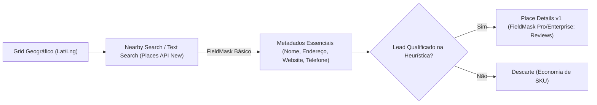
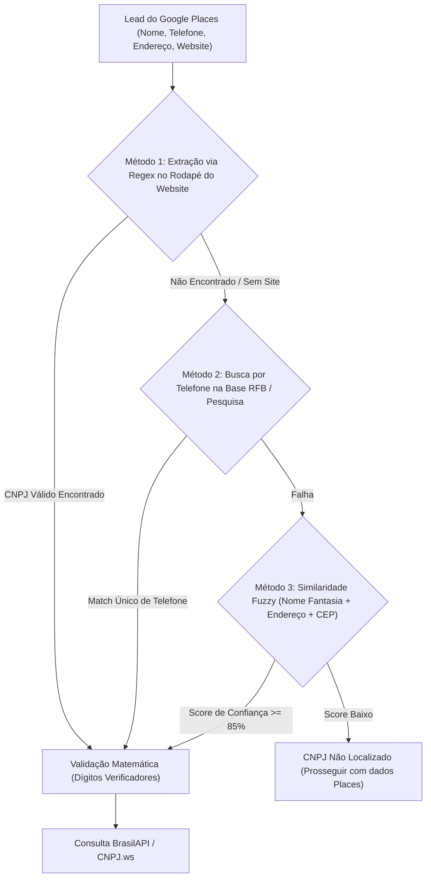
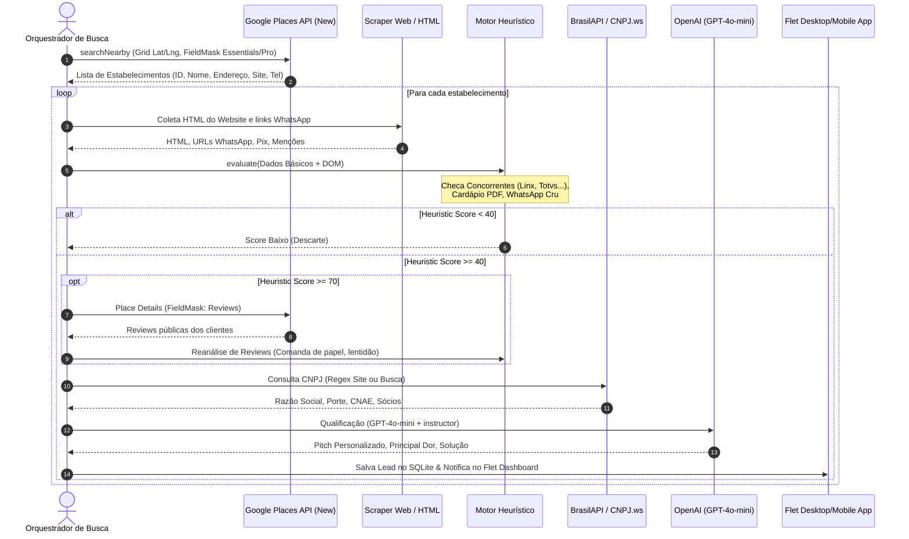

# Guia de Integrações de API — ProspectAI

> Documento de especificação técnica e implementação prática para consumo das APIs externas do **ProspectAI**: Google Places API (New) v1, BrasilAPI, CNPJ.ws e OpenAI (GPT-4o-mini com Instructor).

---

## 1. Google Places API (New) v1

A Google Places API (New) substitui a API legada com maior granularidade de dados, suporte nativo a HTTP POST com corpo JSON e, fundamentalmente, **controle de custos por meio do cabeçalho `X-Goog-FieldMask`**.



### 1.1. Passo a Passo de Ativação no Google Cloud Console

1. Acesse o [Google Cloud Console](https://console.cloud.google.com/).
2. Crie um novo projeto ou selecione o projeto existente (ex.: `prospectai-production`).
3. No menu lateral, acerte em **APIs e Serviços** > **Biblioteca** (*Library*).
4. Pesquise por **Places API (New)** (atenção: selecione a versão *New*, **não** a versão clássica *Places API*).
5. Clique em **Ativar** (*Enable*).
6. Acesse **APIs e Serviços** > **Credenciais** (*Credentials*) e clique em **Criar Credenciais** > **Chave de API** (*API Key*).
7. **Recomendações de Segurança e Restrição**:
   - Restrinja a chave para permitir chamadas exclusivamente da **Places API (New)**.
   - Configure cotas diárias em **APIs e Serviços** > **Places API (New)** > **Cotas e Limites do Sistema** para evitar cobranças acidentais.

---

### 1.2. Otimização de Custos e SKUs via `X-Goog-FieldMask`

A cobrança da Google Places API (New) é calculada de acordo com o SKU determinado pelos campos solicitados no cabeçalho `X-Goog-FieldMask`:

| SKU | Campos Típicos Solicitados | Custo Estimado (por 1.000 requisições) | Aplicação no ProspectAI |
|---|---|---|---|
| **Places Essentials** | `places.id`, `places.displayName`, `places.formattedAddress`, `places.location`, `places.types` | ~$0.00 (Tier gratuito de $200/mês cobre ~40.000 requisições) ou $5.00 | Varredura de Grid Geográfico inicial. |
| **Places Pro** | `places.nationalPhoneNumber`, `places.internationalPhoneNumber`, `places.websiteUri`, `places.regularOpeningHours` | ~$3.00 adicionais | Obtenção de canais de contato e site para scraping. |
| **Places Enterprise** | `places.reviews`, `places.photos` | ~$5.00 a $17.00 adicionais | **Chamado apenas em Place Details** para leads com score heurístico promissor. |

> [!CAUTION]
> **Nunca use wildcard `*` no `X-Goog-FieldMask`**:
> O uso de `X-Goog-FieldMask: *` força o faturamento no SKU mais alto (*Enterprise + Atmosphere*), encarecendo a operação em até 10 vezes. Sempre liste expressamente os campos necessários.

---

### 1.3. Endpoints Principais da Places API (New)

#### A. Text Search (New)
- **URL**: `https://places.googleapis.com/v1/places:searchText`
- **Método**: `POST`
- **Cabeçalhos obrigatórios**:
  - `Content-Type: application/json`
  - `X-Goog-Api-Key: YOUR_API_KEY`
  - `X-Goog-FieldMask: places.id,places.displayName,places.formattedAddress,places.websiteUri,places.nationalPhoneNumber,places.types`
- **Corpo da Requisição (JSON)**:
```json
{
  "textQuery": "restaurante em Pinheiros, São Paulo",
  "languageCode": "pt-BR",
  "maxResultCount": 20,
  "locationBias": {
    "circle": {
      "center": {
        "latitude": -23.5615,
        "longitude": -46.6917
      },
      "radius": 1500.0
    }
  }
}
```

#### B. Nearby Search (New)
- **URL**: `https://places.googleapis.com/v1/places:searchNearby`
- **Método**: `POST`
- **Cabeçalhos obrigatórios**:
  - `Content-Type: application/json`
  - `X-Goog-Api-Key: YOUR_API_KEY`
  - `X-Goog-FieldMask: places.id,places.displayName,places.formattedAddress,places.location,places.websiteUri,places.nationalPhoneNumber,places.types`
- **Corpo da Requisição (JSON)**:
```json
{
  "includedTypes": ["restaurant", "bar", "bakery"],
  "maxResultCount": 20,
  "locationRestriction": {
    "circle": {
      "center": {
        "latitude": -23.5615,
        "longitude": -46.6917
      },
      "radius": 1000.0
    }
  }
}
```

#### C. Place Details (New)
- **URL**: `https://places.googleapis.com/v1/places/{placeId}`
- **Método**: `GET`
- **Cabeçalhos obrigatórios**:
  - `X-Goog-Api-Key: YOUR_API_KEY`
  - `X-Goog-FieldMask: id,displayName,formattedAddress,reviews,rating,userRatingCount,websiteUri,nationalPhoneNumber`
- **Utilização**: Executado pontualmente para recuperar comentários (`reviews`) para análise heurística textual de fricção e comanda de papel.

---

### 1.4. Catálogo de `includedTypes` para o Mercado Brasileiro

Para focar em segmentos com alta dor de automação comercial e PDV, utilize os seguintes tipos suportados pela Places API (New):

| Segmento | Tipos Aceitos (`includedTypes`) | Foco de Venda de Software |
|---|---|---|
| **Alimentação & Bebidas (Food)** | `restaurant`, `cafe`, `bar`, `bakery`, `meal_takeaway`, `meal_delivery`, `ice_cream_shop`, `fast_food_restaurant`, `pizza_restaurant` | PDV de Balcão, Comanda Eletrônica, Integração iFood, Cardápio Digital QR |
| **Varejo & Comércio Local** | `clothing_store`, `shoe_store`, `electronics_store`, `grocery_store`, `supermarket`, `convenience_store`, `pet_store`, `pharmacy`, `hardware_store`, `jewelry_store`, `home_goods_store` | Frente de Caixa Fiscal (NFC-e/SAT), Controle de Estoque com Código de Barras |
| **Beleza, Estética & Bem-Estar** | `beauty_salon`, `hair_care`, `barber_shop`, `spa` | Agendamento Online, Comissões de Profissionais, Split de Pagamento |
| **Automotivo & Serviços** | `car_repair`, `auto_parts_store`, `car_wash` | Ordem de Serviço (OS), Controle de Peças, Emissão de NFS-e |
| **Saúde & Clínicas** | `dental_clinic`, `doctor`, `veterinary_care` | Prontuário, Agenda de Consultas, Receituário e Faturamento |

---

### 1.5. Exemplo de Cliente Python Assíncrono com `httpx`

```python
# integrations/google_places.py
from typing import List, Dict, Any, Optional
import httpx
from tenacity import retry, stop_after_attempt, wait_exponential, retry_if_exception_type

class GooglePlacesClient:
    BASE_URL = "https://places.googleapis.com/v1"

    def __init__(self, api_key: str):
        self.api_key = api_key
        self.headers = {
            "Content-Type": "application/json",
            "X-Goog-Api-Key": self.api_key,
        }

    @retry(
        stop=stop_after_attempt(3),
        wait=wait_exponential(multiplier=1, min=2, max=10),
        retry=retry_if_exception_type(httpx.HTTPStatusError)
    )
    async def search_nearby(
        self,
        lat: float,
        lng: float,
        radius_meters: float,
        included_types: List[str],
        max_results: int = 20
    ) -> List[Dict[str, Any]]:
        """Busca estabelecimentos em um raio geográfico usando Nearby Search."""
        url = f"{self.BASE_URL}/places:searchNearby"
        headers = {
            **self.headers,
            "X-Goog-FieldMask": (
                "places.id,places.displayName,places.formattedAddress,"
                "places.location,places.websiteUri,places.nationalPhoneNumber,places.types"
            )
        }
        payload = {
            "includedTypes": included_types,
            "maxResultCount": max_results,
            "locationRestriction": {
                "circle": {
                    "center": {"latitude": lat, "longitude": lng},
                    "radius": radius_meters
                }
            }
        }

        async with httpx.AsyncClient(timeout=10.0) as client:
            response = await client.post(url, headers=headers, json=payload)
            response.raise_for_status()
            data = response.json()
            return data.get("places", [])

    async def get_place_details_reviews(self, place_id: str) -> Optional[Dict[str, Any]]:
        """Recupera avaliações detalhadas para leads qualificados."""
        url = f"{self.BASE_URL}/places/{place_id}"
        headers = {
            **self.headers,
            "X-Goog-FieldMask": "id,displayName,reviews,rating,userRatingCount"
        }

        async with httpx.AsyncClient(timeout=8.0) as client:
            response = await client.get(url, headers=headers)
            if response.status_code == 200:
                return response.json()
            return None
```

---

## 2. BrasilAPI (Enriquecimento Cadastral de CNPJ)

A [BrasilAPI](https://brasilapi.com.br/) é uma API aberta e pública que centraliza dados governamentais brasileiros, incluindo a base da Receita Federal do Brasil (RFB).

- **Endpoint Oficial**: `GET https://brasilapi.com.br/api/cnpj/v1/{cnpj}`
- **Autenticação**: Nenhuma (Open Source / Aberta)
- **Rate Limit**: Gerenciado via Cloudflare. Suporta confortavelmente ~1 a 3 requisições por segundo por IP. Sob requisições em rajada (*burst*), pode retornar código HTTP `429 Too Many Requests`.

### 2.1. Campos Estruturados Retornados

| Campo | Tipo | Significado para o ProspectAI |
|---|---|---|
| `cnpj` | `string` | CNPJ de 14 dígitos (sem máscara). |
| `razao_social` | `string` | Razão social registrada na Receita Federal. |
| `nome_fantasia` | `string` | Nome fantasia público (comparado com o nome do Google Maps). |
| `situacao_cadastral` | `string` | Deve ser `"ATIVA"`. Se for `"BAIXADA"` ou `"INAPTA"`, o lead é descartado. |
| `cnae_fiscal` | `int` | Código principal de atividade econômica (classificação de nicho). |
| `cnae_fiscal_descricao` | `string` | Ex.: "Restaurantes e similares" ou "Comércio varejista de vestuário". |
| `porte` | `string` | `"MEI"`, `"MICRO EMPRESA"`, `"EMPRESA DE PEQUENO PORTE"` ou `"DEMAIS"`. |
| `capital_social` | `float` | Capacidade financeira declarada da empresa. |
| `data_inicio_atividade`| `string` | Data de abertura (ex.: `2024-03-15`). Permite calcular a idade do negócio. |
| `ddd_telefone_1` | `string` | Telefone principal registrado (usado para cruzamento com Places). |
| `logradouro`, `numero` | `string` | Endereço fiscal para confirmação física com o Google Places. |
| `qsa` | `list[dict]` | Quadro de Sócios e Administradores (usado para saudar o tomador de decisão). |

### 2.2. Exemplo de Cliente Python com Modelagem Pydantic v2

```python
# integrations/brasil_api.py
from typing import Optional, List
import httpx
from pydantic import BaseModel, Field
from tenacity import retry, stop_after_attempt, wait_exponential, retry_if_exception_type

class Socio(BaseModel):
    nome_socio: str
    qualificacao_socio: Optional[str] = None

class CNPJData(BaseModel):
    cnpj: str
    razao_social: str
    nome_fantasia: Optional[str] = ""
    situacao_cadastral: str
    cnae_fiscal: int
    cnae_fiscal_descricao: str
    porte: str
    capital_social: float
    data_inicio_atividade: str
    logradouro: str
    numero: str
    municipio: str
    uf: str
    ddd_telefone_1: Optional[str] = None
    qsa: List[Socio] = Field(default_factory=list)

class BrasilAPIClient:
    BASE_URL = "https://brasilapi.com.br/api/cnpj/v1"

    @retry(
        stop=stop_after_attempt(3),
        wait=wait_exponential(multiplier=1.5, min=1, max=5),
        retry=retry_if_exception_type((httpx.ConnectTimeout, httpx.ReadTimeout))
    )
    async def fetch_cnpj(self, cnpj: str) -> Optional[CNPJData]:
        # Remove caracteres de pontuação
        clean_cnpj = "".join(filter(str.isdigit, cnpj))
        if len(clean_cnpj) != 14:
            return None

        url = f"{self.BASE_URL}/{clean_cnpj}"
        async with httpx.AsyncClient(timeout=8.0) as client:
            resp = await client.get(url)
            if resp.status_code == 200:
                return CNPJData.model_validate(resp.json())
            elif resp.status_code == 404:
                return None
            elif resp.status_code == 429:
                raise httpx.HTTPStatusError("Rate limited on BrasilAPI", request=resp.request, response=resp)
            return None
```

---

## 3. CNPJ.ws (Provedor de Fallback)

Quando a BrasilAPI sofrer indisponibilidade temporária ou atingir o limite de taxa (HTTP 429), o **ProspectAI** aciona o fallback para a API pública do [CNPJ.ws](https://www.cnpj.ws/).

- **Endpoint Oficial**: `GET https://publica.cnpj.ws/cnpj/{cnpj}`
- **Autenticação no Plano Gratuito**: Nenhuma.
- **Limitação Estrita**: **3 consultas por minuto** por IP no plano gratuito.

> [!WARNING]
> Devido ao limite de 3 req/min do CNPJ.ws gratuito, esta rota deve ser protegida por um semáforo ou *Token Bucket Rate Limiter* assíncrono para evitar bloqueios por IP.

### 3.1. Diferenças Estruturais de Payload

Enquanto a BrasilAPI retorna um JSON com chaves na raiz (`razao_social`, `logradouro`), o CNPJ.ws divide a resposta entre `estabelecimento` e dados da matriz:
- Razão Social: `data["razao_social"]`
- Nome Fantasia: `data["estabelecimento"]["nome_fantasia"]`
- Cidade: `data["estabelecimento"]["cidade"]["nome"]`
- Porte: `data["porte"]["descricao"]`

### 3.2. Implementação do Adaptador de Fallback

```python
# integrations/cnpj_resolver.py
import asyncio
from typing import Optional
import httpx
from integrations.brasil_api import BrasilAPIClient, CNPJData

class CNPJResolver:
    def __init__(self, brasil_client: BrasilAPIClient):
        self.brasil_client = brasil_client
        self._cnpj_ws_semaphore = asyncio.Semaphore(1)  # Controle de taxa para CNPJ.ws
        self._last_cnpj_ws_call = 0.0

    async def get_company_data(self, cnpj: str) -> Optional[CNPJData]:
        clean_cnpj = "".join(filter(str.isdigit, cnpj))
        
        # 1. Tentar BrasilAPI primeiro
        try:
            data = await self.brasil_client.fetch_cnpj(clean_cnpj)
            if data:
                return data
        except Exception:
            pass  # Prossiga para o fallback

        # 2. Fallback: CNPJ.ws com espaçamento de requisição
        async with self._cnpj_ws_semaphore:
            url = f"https://publica.cnpj.ws/cnpj/{clean_cnpj}"
            async with httpx.AsyncClient(timeout=10.0) as client:
                resp = await client.get(url)
                if resp.status_code == 200:
                    raw = resp.json()
                    est = raw.get("estabelecimento", {})
                    # Normaliza para a mesma estrutura Pydantic CNPJData
                    return CNPJData(
                        cnpj=clean_cnpj,
                        razao_social=raw.get("razao_social", ""),
                        nome_fantasia=est.get("nome_fantasia") or "",
                        situacao_cadastral=est.get("situacao_cadastral", "ATIVA"),
                        cnae_fiscal=int(est.get("atividade_principal", {}).get("id", 0)),
                        cnae_fiscal_descricao=est.get("atividade_principal", {}).get("descricao", ""),
                        porte=raw.get("porte", {}).get("descricao", "MICRO EMPRESA"),
                        capital_social=float(raw.get("capital_social", 0.0)),
                        data_inicio_atividade=est.get("data_inicio_atividade", ""),
                        logradouro=f"{est.get('tipo_logradouro', '')} {est.get('logradouro', '')}".strip(),
                        numero=est.get("numero", "S/N"),
                        municipio=est.get("cidade", {}).get("nome", ""),
                        uf=est.get("estado", {}).get("sigla", ""),
                        ddd_telefone_1=est.get("telefone1", "")
                    )
        return None
```

---

## 4. OpenAI API com `instructor` (GPT-4o-mini)

O `GPT-4o-mini` é utilizado na fase final do pipeline exclusivamente para leads que atingiram `Score Heurístico >= 70`. Seu objetivo não é descobrir dados brutos, mas realizar uma **síntese estratégica**: identificar as dores mais críticas, preparar argumentos de venda e redigir uma mensagem de abordagem via WhatsApp sob medida.

### 4.1. Estimativa de Custos Operacionais

| Métrica | Valor Médio |
|---|---|
| Tokens de Entrada (Prompt do Sistema + Dados Estruturados) | ~700 tokens |
| Tokens de Saída (JSON Estruturado Pydantic) | ~350 tokens |
| Custo Entrada (`gpt-4o-mini`: $0.15 / 1M tokens) | $0.000105 por lead |
| Custo Saída (`gpt-4o-mini`: $0.60 / 1M tokens) | $0.000210 por lead |
| **Custo Total por Lead Qualificado** | **~$0.000315 (~ R$ 0,0018)** |
| **Custo para 1.000 Leads Altamente Qualificados** | **~$0,31 USD (~ R$ 1,80)** |

A estratégia de filtro prévio por heurísticas reduz o gasto total em até 85%, descartando antecipadamente estabelecimentos que já usam sistemas como Linx, Totvs ou Anota AI.

### 4.2. Modelagem Estruturada e Execução via `instructor`

```python
# qualification/llm_qualifier.py
import os
from typing import List, Optional
from openai import AsyncOpenAI
import instructor
from pydantic import BaseModel, Field

class QualificationResult(BaseModel):
    is_hot_lead: bool = Field(description="Verdadeiro se o negócio claramente opera sem sistema e tem alto potencial de compra.")
    urgency_level: str = Field(description="'ALTA', 'MEDIA' ou 'BAIXA'")
    primary_pain_point: str = Field(description="A dor mais gritante detectada na operação (ex: 'Falta de comanda eletrônica gerando fila e erro de pedidos').")
    recommended_solution: str = Field(description="Produto sugerido: 'PDV Balcão', 'Cardápio Digital QR', 'Comanda Mobile' ou 'ERP Integrado'.")
    whatsapp_pitch: str = Field(description="Mensagem de abordagem hiperpersonalizada para WhatsApp, informal e consultiva em português do Brasil.")
    objection_risk: str = Field(description="Principal objeção provável do dono (ex: 'Acha que o negócio é pequeno demais para ter sistema').")

class LeadQualifier:
    def __init__(self, api_key: Optional[str] = None):
        client = AsyncOpenAI(api_key=api_key or os.getenv("OPENAI_API_KEY"))
        # Patched com a biblioteca instructor para validação automática de JSON Schema
        self.instructor_client = instructor.from_openai(client)

    async def qualify_lead(
        self,
        business_name: str,
        niche: str,
        heuristic_score: int,
        detected_signals: List[str],
        reviews_summary: List[str],
        cnpj_info: Optional[dict] = None
    ) -> QualificationResult:
        system_prompt = (
            "Você é o especialista líder em vendas e qualificação B2B do ProspectAI no Brasil. "
            "Seu papel é analisar dados de comércios locais (restaurantes, varejos, barbearias, serviços) "
            "e gerar uma avaliação objetiva de propensão à compra de sistemas de PDV, Frente de Caixa, "
            "Cardápio Digital ou ERP. Seja prático, direto e orientado a negócios reais brasileiros."
        )

        user_content = f"""
Nome da Empresa: {business_name}
Nicho / Categoria: {niche}
Score Heurístico: {heuristic_score}/100
Sinais Detectados: {', '.join(detected_signals)}
Resumo de Reclamações e Reviews: {'; '.join(reviews_summary) if reviews_summary else 'Nenhuma review crítica'}
Dados Cadastrais Receita: {cnpj_info or 'Não disponíveis'}

Avalie este lead e estruture o pitch comercial focado nas dores operacionais identificadas.
"""

        result: QualificationResult = await self.instructor_client.chat.completions.create(
            model="gpt-4o-mini",
            response_model=QualificationResult,
            max_retries=2,
            messages=[
                {"role": "system", "content": system_prompt},
                {"role": "user", "content": user_content}
            ],
            temperature=0.2
        )
        return result
```

---

## 5. Estratégias de Cruzamento e Descoberta de CNPJ

Muitos estabelecimentos retornados pelo Google Places não informam o CNPJ diretamente em sua ficha cadastral do Google Maps. Para viabilizar a consulta na BrasilAPI, o **ProspectAI** aplica uma estratégia de descoberta e cruzamento em 3 etapas sequenciais:



### 5.1. Método 1: Extração via Regex no Rodapé do Website

Pela legislação brasileira (Decreto Federal nº 7.962/2013 - Lei do E-commerce), empresas comerciais com website ou presença digital devem exibir seu CNPJ e endereço no rodapé.

#### Expressões Regulares Utilizadas:
```python
# Padrão formatado tradicional: 00.000.000/0001-00
REGEX_CNPJ_MASCARADO = r"\b\d{2}\.\d{3}\.\d{3}/\d{4}-\d{2}\b"

# Padrão contínuo (14 dígitos consecutivos precedidos por termos fiscais):
REGEX_CNPJ_TEXTO = r"(?:cnpj|inscricao\s+estadual|mf)[\s:.]*([0-9]{2}[\.\s]?[0-9]{3}[\.\s]?[0-9]{3}[\/\s]?[0-9]{4}[-\s]?[0-9]{2}|[0-9]{14})"
```

#### Algoritmo de Validação de Dígitos Verificadores (Módulo 11):
```python
def validate_cnpj(cnpj: str) -> bool:
    """Valida se uma sequência numérica de 14 dígitos representa um CNPJ válido."""
    numbers = [int(digit) for digit in cnpj if digit.isdigit()]
    if len(numbers) != 14 or len(set(numbers)) == 1:
        return False

    # Validação do primeiro dígito
    weights_first = [5, 4, 3, 2, 9, 8, 7, 6, 5, 4, 3, 2]
    sum_first = sum(n * w for n, w in zip(numbers[:12], weights_first))
    remainder_first = sum_first % 11
    digit_1 = 0 if remainder_first < 2 else 11 - remainder_first
    if numbers[12] != digit_1:
        return False

    # Validação do segundo dígito
    weights_second = [6, 5, 4, 3, 2, 9, 8, 7, 6, 5, 4, 3, 2]
    sum_second = sum(n * w for n, w in zip(numbers[:13], weights_second))
    remainder_second = sum_second % 11
    digit_2 = 0 if remainder_second < 2 else 11 - remainder_second
    return numbers[13] == digit_2
```

---

### 5.2. Método 2: Cruzamento por Telefone (Google Places vs Receita Federal)

O Google Places fornece o campo `nationalPhoneNumber` (ex.: `(11) 98765-4321` ou `(11) 3456-7890`). A base aberta de empresas da Receita Federal mantém campos como `ddd_telefone_1` e `ddd_telefone_2`.

1. Normalize o telefone removendo caracteres especiais e o DDI `+55`:
   - `"+55 11 98765-4321"` $\rightarrow$ `DDD="11"`, `NUMERO="987654321"`
2. Se o estabelecimento possuir telefone fixo comercial cadastrado na Receita, a unicidade do cruzamento supera 95% de precisão dentro do mesmo município.

---

### 5.3. Método 3: Similaridade Fuzzy de Nome e Endereço (`rapidfuzz`)

Quando não há website ou menção expressa de CNPJ, executa-se busca por nome e endereço no índice local ou base municipal da Receita com a biblioteca de alta performance `rapidfuzz`:

```python
# utils/cnpj_matcher.py
import re
from typing import Optional, Dict, Any, List
from rapidfuzz import fuzz

class CNPJMatcher:
    @staticmethod
    def extract_cnpj_from_html(html_text: str) -> Optional[str]:
        """Varre o HTML em busca de CNPJs válidos no rodapé ou corpo."""
        # 1. Procurar com máscara
        matches = re.findall(r"\b\d{2}\.\d{3}\.\d{3}/\d{4}-\d{2}\b", html_text)
        for candidate in matches:
            clean = "".join(filter(str.isdigit, candidate))
            if validate_cnpj(clean):
                return clean
        return None

    @staticmethod
    def match_by_name_and_address(
        target_name: str,
        target_street: str,
        candidates: List[Dict[str, Any]],
        threshold: float = 85.0
    ) -> Optional[Dict[str, Any]]:
        """
        Compara o nome do Google Maps com a Razão Social/Nome Fantasia da Receita.
        Calcula média ponderada de similaridade do Nome (70%) e Endereço (30%).
        """
        best_match = None
        highest_score = 0.0

        for cand in candidates:
            # Similaridade entre nome do Google Maps e Nome Fantasia / Razão Social
            cand_name = cand.get("nome_fantasia") or cand.get("razao_social", "")
            name_score = fuzz.token_sort_ratio(target_name.lower(), cand_name.lower())

            # Similaridade do endereço
            cand_street = cand.get("logradouro", "")
            street_score = fuzz.partial_ratio(target_street.lower(), cand_street.lower())

            # Score combinado
            total_score = (name_score * 0.7) + (street_score * 0.3)

            if total_score > highest_score and total_score >= threshold:
                highest_score = total_score
                best_match = cand

        return best_match
```

---

## 6. Diagrama de Integração Completo do Pipeline



---

## 7. Variáveis de Ambiente Recomendadas (`.env`)

```ini
# Configuração de APIs Externas - ProspectAI
GOOGLE_PLACES_API_KEY=AIzaSyA...
OPENAI_API_KEY=sk-proj-...

# Timeouts e Limites de Requisição
HTTP_TIMEOUT_SECONDS=10
PLACES_MAX_RESULTS_PER_GRID=20
BRASILAPI_BURST_DELAY=0.4
CNPJ_WS_TOKEN_BUCKET_PER_MIN=3

# Armazenamento e Logs
DATABASE_URL=sqlite+aiosqlite:///data/prospectai.db
LOG_LEVEL=INFO
```
