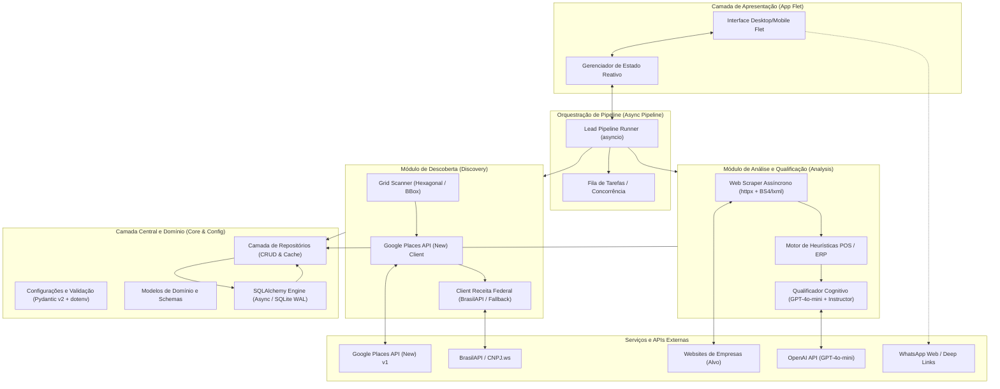
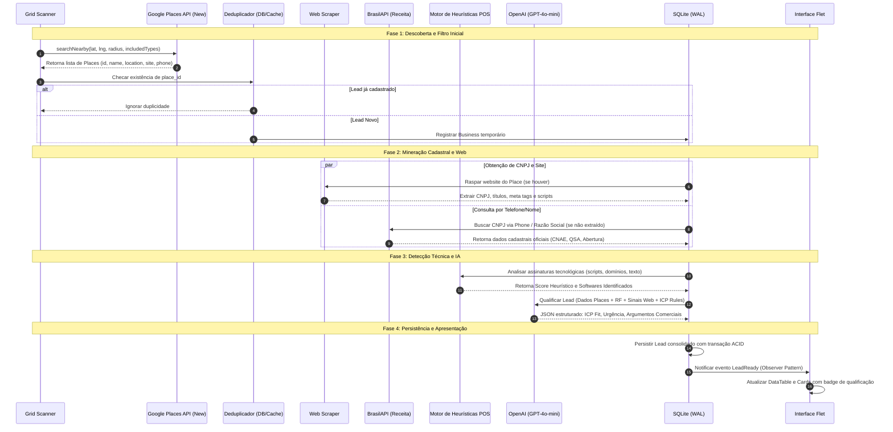
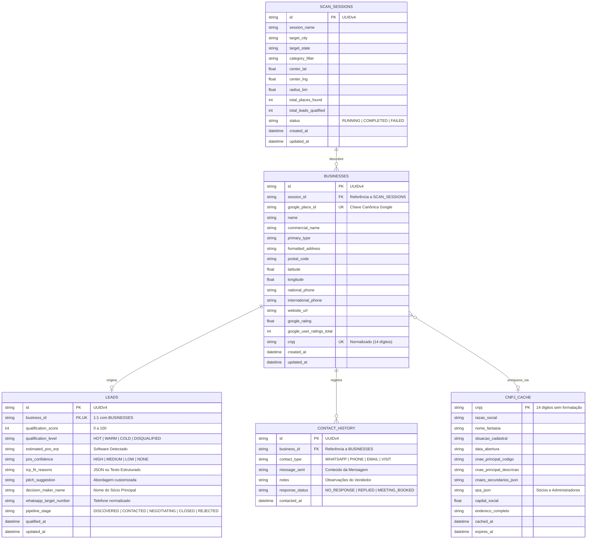
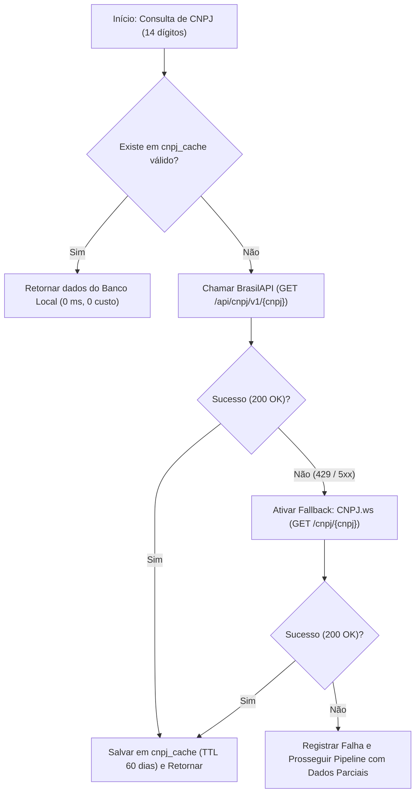
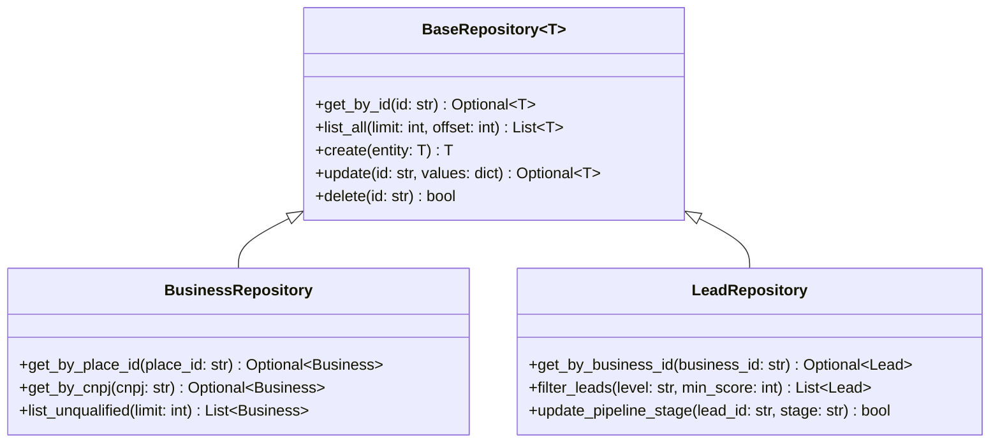
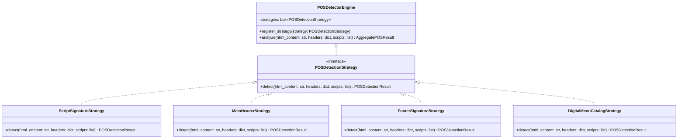
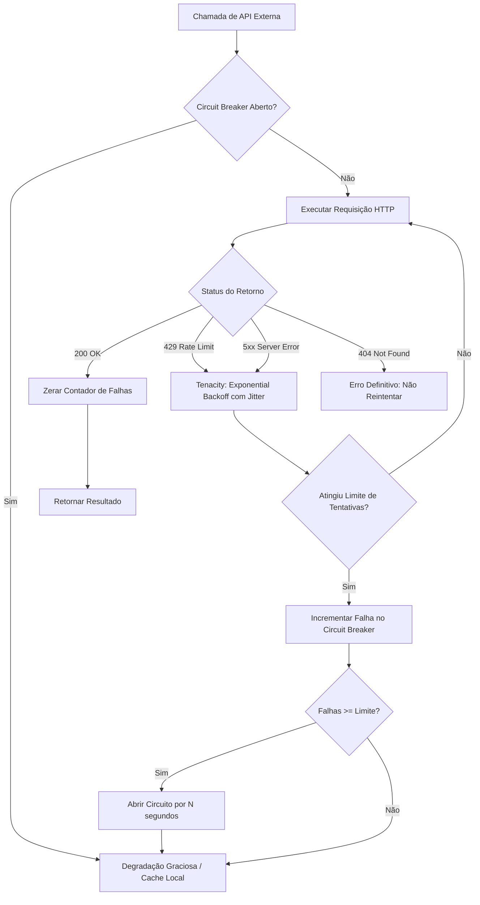
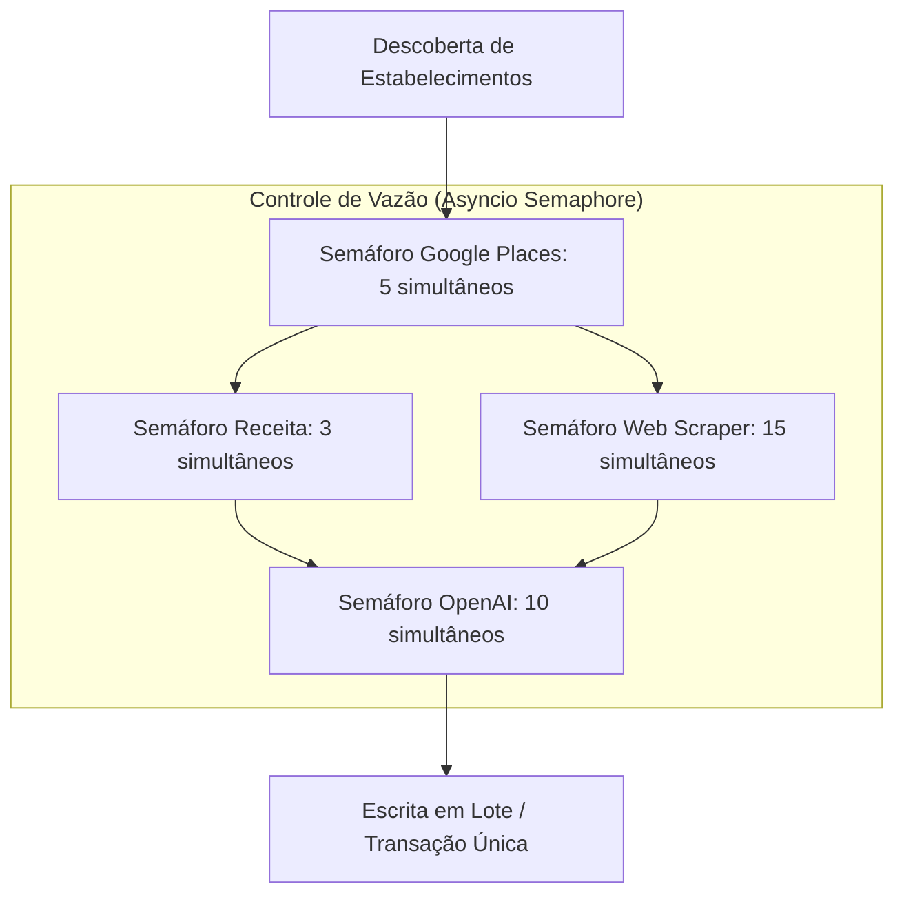

# Arquitetura Técnica do ProspectAI
**Agente Autônomo de Descoberta, Qualificação e Enriquecimento de Leads B2B no Brasil**

---

## 1. Visão Geral da Arquitetura

O **ProspectAI** é uma plataforma modular de inteligência de vendas B2B desenvolvida em Python 3.12+, projetada para automatizar o ciclo completo de prospecção comercial ativa para fornecedores de software (SaaS, ERPs, sistemas de PDV, gateways de pagamento e automação comercial).

### 1.1 Missão e Escopo do Sistema
O sistema resolve os gargalos tradicionais da prospecção outbound no mercado brasileiro:
- **Descoberta hiperlocal precisa**: Varrer bairros, municípios e regiões geográficas sem lacunas espaciais.
- **Validação cadastral oficial**: Obter CNPJ, situação cadastral na Receita Federal e dados do QSA (Quadro de Sócios e Administradores) a partir de informações públicas.
- **Detecção de stack tecnológica**: Descobrir indícios do software de gestão atual utilizado pela empresa-alvo (PDV, ERP, checkout, cardápio digital).
- **Qualificação cognitiva com LLM**: Avaliar a aderência ao Perfil de Cliente Ideal (ICP - *Ideal Customer Profile*) com base em regras de negócio e raciocínio contextual.
- **Prontidão operacional**: Entregar leads qualificados em uma interface desktop/mobile interativa com acionamento direto via WhatsApp.

### 1.2 Diagrama de Arquitetura de Alto Nível



---

## 2. Diagrama e Especificação de Componentes

O software é estruturado sob o paradigma de arquitetura limpa em camadas desacopladas (*Clean Architecture* adaptada), garantindo isolamento entre detalhes de infraestrutura externa, lógica de negócios e interface visual.

```mermaid
graph LR
    subgraph config ["Pacote: config/"]
        Settings["Settings (Pydantic Settings)"]
        LoggingConfig["Configuração de Logs (Rich)"]
        Constants["Constantes de Busca e Rate Limits"]
    end

    subgraph core ["Pacote: core/"]
        Models["Modelos Declarativos (SQLAlchemy)"]
        Schemas["Schemas de Entrada/Saída (Pydantic v2)"]
        Database["Database Session & Engine Factory"]
        BaseRepo["BaseRepository & Generic CRUD"]
    end

    subgraph discovery ["Pacote: discovery/"]
        GridModule["grid_scanner.py (Geometria Geodésica)"]
        PlacesModule["google_places.py (REST Client v1)"]
        ReceitaModule["receita_federal.py (BrasilAPI / CNPJ.ws)"]
    end

    subgraph analysis ["Pacote: analysis/"]
        ScraperModule["web_scraper.py (Coletor HTTP Resiliente)"]
        POSModule["pos_detector.py (Estratégias Heurísticas)"]
        LLMModule["llm_qualifier.py (Instructor + GPT-4o-mini)"]
    end

    subgraph pipeline ["Pacote: pipeline/"]
        LeadPipeline["lead_pipeline.py (Orquestrador de Fases)"]
        Context["PipelineContext & State Machine"]
    end

    subgraph app ["Pacote: app/"]
        MainView["views/main_view.py (Dashboard Principal)"]
        ConfigView["views/config_view.py (Ajustes de Varredura)"]
        LeadDetails["components/lead_card.py & modal.py"]
        WhatsAppAction["components/whatsapp_button.py"]
    end

    config --> core
    config --> discovery
    config --> analysis
    core --> pipeline
    discovery --> pipeline
    analysis --> pipeline
    pipeline --> app
```



### 2.1 Descrição Técnica dos Módulos

| Módulo | Arquivos Principais | Responsabilidade Principal |
| :--- | :--- | :--- |
| `config/` | `settings.py`, `logging.py` | Leitura centralizada de variáveis de ambiente (`.env`), validação estrita com Pydantic Settings, inicialização de formatadores `rich`. |
| `core/` | `database.py`, `models.py`, `schemas.py`, `repositories/` | Sessões do SQLAlchemy assíncrono, declaração de tabelas, modelos Pydantic v2 de transferência, abstração de repositórios. |
| `discovery/` | `grid_scanner.py`, `google_places.py`, `receita_federal.py` | Algoritmos de varredura geográfica (lat/lng grid com haversine), consumo da Google Places API (New) v1 com FieldMask, client assíncrono da BrasilAPI com normalização de CNPJ. |
| `analysis/` | `web_scraper.py`, `pos_detector.py`, `llm_qualifier.py` | Requisições HTTP concorrentes com `httpx`, extração semântica com `BeautifulSoup4`/`lxml`, regex e heurísticas de PDV/ERP, qualificação estruturada com `instructor` e `gpt-4o-mini`. |
| `pipeline/` | `lead_pipeline.py`, `events.py` | Gerenciamento de ciclo de vida assíncrono, controle de concorrência com semáforos, despacho de eventos de progresso e persistência transacional. |
| `app/` | `main.py`, `views/*.py`, `components/*.py` | Interface de usuário multiplataforma desenvolvida em Flet, apresentação de estatísticas em tempo real, filtros dinâmicos e disparo de mensagens via WhatsApp. |

---

## 3. Fluxo de Dados e Ciclo de Vida do Lead (Pipeline)

O pipeline de dados opera como uma máquina de estados sequencial e concorrente. Cada potencial cliente percorre 10 etapas rigorosas de validação, enriquecimento e filtragem.



### 3.1 Detalhamento dos 10 Passos do Pipeline

1. **Geração de Coordenadas de Grid (`Grid Scanner`)**: A partir de um polígono delimitador (*Bounding Box*) ou ponto central com raio definido, o scanner gera uma malha geodésica baseada na fórmula de Haversine com sobreposição programada de 15% para evitar áreas cegas na cobertura de raios circulares do Google.
2. **Varredura no Google Places (New) v1**: A API `places:searchNearby` é consultada para cada nó do grid utilizando filtros restritos a categorias B2B ou comércio alvo (ex: `restaurant`, `clothing_store`, `supermarket`, `pharmacy`).
3. **Deduplicação por `place_id`**: O `place_id` canônico do Google atua como chave de unicidade primária. Registros pré-existentes na sessão ou no banco têm suas coordenadas atualizadas, pulando etapas redundantes.
4. **Extração e Descoberta de CNPJ**: O pipeline executa uma varredura no site do estabelecimento (páginas `Home`, `/contato`, `/termos`, `/politica-de-privacidade`) buscando padrões de regex para CNPJ brasileiro `\d{2}\.\d{3}\.\d{3}/\d{4}-\d{2}`. Em caso de ausência, realiza correspondência reversa por telefone ou nome comercial.
5. **Enriquecimento Cadastral (Receita Federal via BrasilAPI)**: Consulta assíncrona do CNPJ extraído. Obtenção do CNAE primário/secundário, natureza jurídica, data de abertura, capital social, situação cadastral (`ATIVA`, `BAIXADA`, `SUSPENSA`) e quadro de sócios (QSA) com nomes dos sócios/administradores para contato direto.
6. **Web Scraping de Sinais Tecnológicos**: Coleta de scripts externos, folhas de estilo, chamadas de iframe, rodapés e links externos para mapear a infraestrutura digital do negócio.
7. **Scoring Heurístico de PDV/ERP**: O motor avalia correspondências de assinaturas contra um dicionário conhecido de provedores de software brasileiros (ex: Linx, Totvs, Bematech, Alterdata, Omie, Bling, Anymarket, Saipos, iFood Loop, Trinks, etc.).
8. **Qualificação Cognitiva com GPT-4o-mini + Instructor**: O modelo de linguagem recebe um resumo limpo dos dados cadastrais e dos sinais de software, respondendo via *Structured Output* estrito com nota de 0 a 100, nível de urgência, sistema atual estimado e sugestão de abordagem para o vendedor.
9. **Persistência Transacional no SQLite**: O lead, o negócio associado e o histórico de análise são gravados no banco de dados sob modo WAL (*Write-Ahead Logging*).
10. **Renderização e Interação na UI Flet**: A interface gráfica é notificada através do padrão Observer, renderizando o lead de forma reativa com botões de ação imediata (Link universal do WhatsApp pré-formatado com texto de quebra-gelo).

---

## 4. Camada de Dados e Persistência

### 4.1 Diagrama Entidade-Relacionamento (ERD)



### 4.2 SQLite no MVP com Modo WAL
Para o MVP desktop/monolítico do ProspectAI, o **SQLite 3** foi selecionado para simplificar a entrega (zero dependências de infraestrutura externa ou containers no ambiente do usuário). No entanto, para suportar operações de escrita do pipeline assíncrono simultaneamente à navegação do usuário na UI do Flet, a conexão implementa as seguintes diretivas fundamentais de alta concorrência:

```sql
-- Ativação do Write-Ahead Logging para concorrência de leitura e escrita
PRAGMA journal_mode = WAL;

-- Sincronização normal: excelente equilíbrio entre segurança e throughput
PRAGMA synchronous = NORMAL;

-- Tempo de espera de até 10 segundos antes de lançar 'database is locked'
PRAGMA busy_timeout = 10000;

-- Habilita integridade referencial estrita
PRAGMA foreign_keys = ON;

-- Cache de páginas em memória para leitura ultrarrápida (64MB)
PRAGMA cache_size = -64000;

-- Armazenamento de arquivos temporários em memória RAM
PRAGMA temp_store = MEMORY;
```

### 4.3 Estratégia de Migração para PostgreSQL + PostGIS
Conforme a aplicação evolua de uma instalação desktop individual para uma versão SaaS corporativa multiusuário, o ORM (SQLAlchemy 2.0) permite uma transição sem esforço de reescrita de código de negócio:

1. **Camada de Abstração via SQLAlchemy**: Todos os modelos declarativos utilizam tipos padrão compatíveis com PostgreSQL (`String`, `Integer`, `Float`, `DateTime`, `JSON`).
2. **Extensão PostGIS**: As colunas de latitude e longitude em `BUSINESSES` e `SCAN_SESSIONS` serão migradas para o tipo `geography(Point, 4326)`:
   ```sql
   -- Exemplo de consulta espacial nativa com PostGIS:
   SELECT id, name, formatted_address 
   FROM businesses 
   WHERE ST_DWithin(
       geom_location, 
       ST_SetSRID(ST_MakePoint(-46.6544, -23.5631), 4326)::geography, 
       5000 -- Raio de 5km
   );
   ```
3. **Indexação Espacial**: Criação de índices GiST (`CREATE INDEX idx_businesses_geom ON businesses USING GIST (geom_location);`), reduzindo o tempo de deduplicação e busca espacial de $O(N)$ para $O(\log N)$.
4. **Gerenciamento de Migrações com Alembic**: O versionamento de schema com Alembic já se encontra configurado no projeto desde o MVP, garantindo que as tabelas SQLite possam ser aplicadas ao PostgreSQL via comandos `alembic upgrade head`.

---

## 5. Integrações Externas e APIs

### 5.1 Google Places API (New) v1

A aplicação consome a nova geração da API do Google Places (lançada no final de 2023), que abandona a interface legado (`maps.googleapis.com/maps/api/place/*`) em favor de uma API REST v1 moderna e econômica baseada em **Field Masks**.

#### 5.1.1 Endpoint e Parâmetros
- **Método**: `POST`
- **URL**: `https://places.googleapis.com/v1/places:searchNearby`
- **Headers**:
  - `Content-Type: application/json`
  - `X-Goog-Api-Key: {GOOGLE_PLACES_API_KEY}`
  - `X-Goog-FieldMask: places.id,places.displayName,places.primaryType,places.types,places.formattedAddress,places.location,places.nationalPhoneNumber,places.internationalPhoneNumber,places.websiteUri,places.rating,places.userRatingCount`

#### 5.1.2 Payload de Requisição
```json
{
  "includedTypes": ["restaurant", "bar", "bakery", "cafe"],
  "maxResultCount": 20,
  "locationRestriction": {
    "circle": {
      "center": {
        "latitude": -23.563099,
        "longitude": -46.654388
      },
      "radius": 1500.0
    }
  }
}
```

#### 5.1.3 Otimização de Custos e SKU Tiers
A Places API (New) precifica chamadas estritamente de acordo com os campos solicitados no `X-Goog-FieldMask`. A arquitetura do ProspectAI evita deliberadamente os campos mais caros:

| SKU Tier | Campos Solicitados | No ProspectAI? | Justificativa |
| :--- | :--- | :---: | :--- |
| **Basic** | `id`, `displayName`, `types`, `location`, `formattedAddress` | **Sim** | Identificação física e geográfica elementar. |
| **Advanced** | `nationalPhoneNumber`, `internationalPhoneNumber`, `websiteUri`, `rating`, `userRatingCount` | **Sim** | Canais de contato indispensáveis para mineração de CNPJ e abordagem de vendas. |
| **Preferred / Atmosphere** | `reviews`, `openingHours`, `priceLevel`, `editorialSummary`, `photos` | **Não** | Desnecessários para o ICP e encarecem a chamada em mais de 300%. |

---

### 5.2 BrasilAPI e Fallback (CNPJ.ws)

A obtenção de dados oficiais na Receita Federal é feita priorizando infraestrutura aberta e de alta performance:



#### 5.2.1 Especificação dos Endpoints
1. **Primário - BrasilAPI**:
   - `GET https://brasilapi.com.br/api/cnpj/v1/{cnpj}`
   - Limite de taxa: ~100 req/min (comportamento comunitário elástico).
   - Retorno: CNAE principal, CNAEs secundários, Razão Social, QSA, Endereço, Situação Cadastral.
2. **Fallback - CNPJ.ws Pública**:
   - `GET https://publica.cnpj.ws/cnpj/{cnpj}`
   - Limite de taxa: 3 req/minuto na camada pública sem chave, ou token gratuito com cota diária.
3. **Estratégia de Cache**: Toda resposta válida tem TTL de 60 dias em `cnpj_cache`. Como os dados na Receita Federal de pequenas e médias empresas mudam raramente, isso reduz as chamadas de rede em mais de 80% em varreduras reincidentes.

---

### 5.3 OpenAI API e Qualificação Estruturada com Instructor

Para a camada de cognição, utilizamos a biblioteca `instructor` sobre o SDK oficial da OpenAI. Isso garante a geração direta de instâncias Pydantic através de chamadas a `client.chat.completions.create` com argumentos estritos de resposta (`tool_choice` e `response_model`).

#### 5.3.1 Modelo de Dados para Validação Estrita (Pydantic v2)
```python
from pydantic import BaseModel, Field
from typing import List, Optional
from enum import Enum

class QualificationTier(str, Enum):
    HOT = "HOT"
    WARM = "WARM"
    COLD = "COLD"
    DISQUALIFIED = "DISQUALIFIED"

class SoftwarePresence(str, Enum):
    CONFIRMED = "CONFIRMED"
    PROBABLE = "PROBABLE"
    UNKNOWN = "UNKNOWN"
    ABSENT = "ABSENT"

class LeadQualificationResult(BaseModel):
    qualification_score: int = Field(
        ..., 
        ge=0, 
        le=100, 
        description="Nota de 0 a 100 indicando a aderência ao perfil de cliente ideal (ICP)"
    )
    qualification_level: QualificationTier = Field(
        ..., 
        description="Classificação categórica do lead"
    )
    estimated_current_software: Optional[str] = Field(
        None, 
        description="Nome do software de PDV/ERP/E-commerce identificado ou inferido"
    )
    pos_software_presence: SoftwarePresence = Field(
        ..., 
        description="Grau de certeza da presença de sistema tecnológico atual"
    )
    key_selling_points: List[str] = Field(
        ..., 
        description="Lista de 2 a 4 pontos de valor para o vendedor abordar este cliente"
    )
    suggested_whatsapp_pitch: str = Field(
        ..., 
        description="Mensagem personalizada pronta para envio via WhatsApp em tom amigável e profissional"
    )
    disqualification_reason: Optional[str] = Field(
        None, 
        description="Se o lead for desqualificado, motivo explícito (ex: empresa inativa, porte incompatível)"
    )
```

#### 5.3.2 Otimizações de Custo de LLM
- **Modelo Utilizado**: `gpt-4o-mini`. O custo de inferência é de aproximadamente $0.15 / 1M tokens de entrada e $0.60 / 1M tokens de saída, representando uma economia de ~95% em relação ao `gpt-4o` completo, mantendo precisão equivalente para tarefas de extração estruturada.
- **Compressão de Prompt**: O HTML bruto nunca é enviado ao LLM. O `web_scraper` extrai apenas textos de rodapés, nomes de scripts, meta-descrições e termos específicos relacionados a tecnologia.
- **Cache de Avaliação**: O resultado da qualificação é imutável para a mesma combinação de dados do Places e CNPJ, prevenindo reavaliações desnecessárias.

---

## 6. Padrões de Projeto (Design Patterns)

### 6.1 Repository Pattern (Acesso a Dados)
Isola o domínio de regras de negócio das particularidades do SQLAlchemy e das operações de banco de dados.



**Exemplo de Implementação Técnica do Repositório**:
```python
from typing import Generic, TypeVar, Type, Optional, List
from sqlalchemy.ext.asyncio import AsyncSession
from sqlalchemy import select

T = TypeVar("T")

class BaseRepository(Generic[T]):
    def __init__(self, model_class: Type[T], session: AsyncSession):
        self.model_class = model_class
        self.session = session

    async def get_by_id(self, entity_id: str) -> Optional[T]:
        return await self.session.get(self.model_class, entity_id)

    async def create(self, entity: T) -> T:
        self.session.add(entity)
        await self.session.flush()
        return entity

class BusinessRepository(BaseRepository):
    async def get_by_place_id(self, place_id: str):
        stmt = select(self.model_class).where(self.model_class.google_place_id == place_id)
        result = await self.session.execute(stmt)
        return result.scalar_one_or_none()
```

---

### 6.2 Strategy Pattern (Detecção Heurística de PDV/ERP)
Permite adicionar novas regras e algoritmos de detecção tecnológica sem modificar o código do analisador principal (*Open/Closed Principle*).



**Exemplo de Implementação**:
```python
from abc import ABC, abstractmethod
from typing import List, Dict, Any
from dataclasses import dataclass

@dataclass
class POSDetectionResult:
    detected_system: str
    category: str  # ERP, PDV, ECOMMERCE, DIGITAL_MENU
    confidence: float  # 0.0 a 1.0
    evidence: str

class POSDetectionStrategy(ABC):
    @abstractmethod
    def detect(self, html: str, scripts: List[str], headers: Dict[str, str]) -> List[POSDetectionResult]:
        pass

class ScriptSignatureStrategy(POSDetectionStrategy):
    SIGNATURES = {
        "linx": ("Linx Sistemas", "ERP/PDV"),
        "totvs": ("TOTVS", "ERP"),
        "saipos": ("Saipos", "PDV Gastronômico"),
        "cardapioweb": ("Cardápio Web", "Cardápio Digital"),
        "trinks": ("Trinks", "Gestão de Salões e Barbearias"),
    }

    def detect(self, html: str, scripts: List[str], headers: Dict[str, str]) -> List[POSDetectionResult]:
        results = []
        for script_url in scripts:
            url_lower = script_url.lower()
            for key, (name, category) in self.SIGNATURES.items():
                if key in url_lower:
                    results.append(POSDetectionResult(
                        detected_system=name,
                        category=category,
                        confidence=0.95,
                        evidence=f"Script tag correspondente: {script_url}"
                    ))
        return results
```

---

### 6.3 Pipeline Pattern (Processamento de Leads)
Encadeia operações de processamento de maneira desacoplada. Cada estágio executa uma operação e enriquece um objeto de contexto compartilhado (`PipelineContext`).

```mermaid
graph LR
    Input[Contexto Inicial] --> S1[Stage 1: Geocoding & Grid]
    S1 --> S2[Stage 2: Places API Fetch]
    S2 --> S3[Stage 3: Deduplication]
    S3 --> S4[Stage 4: CNPJ Mining]
    S4 --> S5[Stage 5: Receita Federal]
    S5 --> S6[Stage 6: Web Scraping]
    S6 --> S7[Stage 7: POS Heuristics]
    S7 --> S8[Stage 8: LLM Qualification]
    S8 --> S9[Stage 9: DB Persistence]
    S9 --> Output[Contexto Final / Evento UI]
```



---

### 6.4 Observer / Event Pattern (Atualização Reativa da UI Flet)
Para manter a interface Flet responsiva e livre de travamentos sem acoplamento direto com o pipeline assíncrono:

1. O `LeadPipeline` emite eventos (`SessionProgressEvent`, `LeadDiscoveredEvent`, `LeadQualifiedEvent`, `PipelineErrorEvent`).
2. A camada de apresentação assina os eventos via *Pub/Sub* assíncrono.
3. Conforme novos leads são qualificados pela thread de background, os componentes da UI executam chamadas para `page.update()` atualizando gauges de progresso, contadores e tabelas instantaneamente.

---

## 7. Resiliência e Tratamento de Erros

A operação do ProspectAI envolve múltiplas chamadas de rede externas suscetíveis a oscilações, bloqueios (*Cloudflare*, *WAF*) e esgotamento de cotas de APIs.



### 7.1 Estratégia de Retry com `tenacity`
Todas as funções clientes externas utilizam decoradores da biblioteca `tenacity` com *Exponential Backoff* e *Random Jitter* para evitar o problema da manada (*thundering herd*):

```python
from tenacity import retry, wait_exponential_jitter, stop_after_attempt, retry_if_exception_type
import httpx

class RateLimitOrTransientError(Exception):
    pass

@retry(
    stop=stop_after_attempt(5),
    wait=wait_exponential_jitter(initial=1.0, max=30.0, jitter=1.5),
    retry=retry_if_exception_type((httpx.ConnectTimeout, httpx.ReadTimeout, RateLimitOrTransientError)),
    reraise=True
)
async def fetch_with_retry(client: httpx.AsyncClient, url: str) -> httpx.Response:
    response = await client.get(url, timeout=10.0)
    if response.status_code == 429:
        raise RateLimitOrTransientError("Cota temporariamente excedida (HTTP 429).")
    if response.status_code >= 500:
        raise RateLimitOrTransientError(f"Erro no servidor remoto: {response.status_code}")
    return response
```

### 7.2 Padrão Circuit Breaker
Quando um serviço externo (como a BrasilAPI pública) fica indisponível por tempo prolongado:
- **Estado Fechado (Closed)**: Requisições fluem normalmente. Falhas são contabilizadas em uma janela deslizante.
- **Estado Aberto (Open)**: Ao atingir 5 falhas consecutivas, o circuito abre por 60 segundos. Chamadas subsequentes nem tentam a rede; vão direto para o fallback (CNPJ.ws ou continuar sem dados cadastrais).
- **Estado Meio-Aberto (Half-Open)**: Após 60 segundos, uma única requisição de teste é liberada. Se funcionar, o circuito fecha; se falhar, retorna ao estado aberto.

### 7.3 Degradação Graciosa (Graceful Degradation)
O pipeline nunca aborta a qualificação de um lead por falha em uma etapa acessória:
- Se o **website estiver fora do ar** ou bloquear com HTTP 403 (Cloudflare): o sistema continua utilizando as informações do Google Places e da Receita Federal.
- Se o **CNPJ não for descoberto**: o lead é qualificado com base no volume de avaliações, categoria e presença digital encontrada no Google Places.
- Se a **API da OpenAI falhar**: o lead recebe um score baseado puramente nas heurísticas determinísticas do `pos_detector`.

---

## 8. Registros de Decisões Arquiteturais (ADRs)

### ADR-001: Adoção da Google Places API (New) v1 vs. Legacy Places API
- **Status**: Aprovado
- **Contexto**: O Google Maps Platform descontinuará progressivamente os endpoints legados (`Place Search` e `Place Details`). A nova API v1 adota o padrão de máscaras de campos (`FieldMask`) e agrupamento simplificado em `searchNearby`.
- **Decisão**: Adotar exclusivamente a Google Places API (New) v1.
- **Consequências**:
  - *Positivas*: Redução de custos em até 70% solicitando apenas os SKUs estritamente necessários; resposta em payload JSON moderno; conformidade com os novos limites globais da plataforma.
  - *Negativas*: Mudança nos nomes de campos em relação a tutoriais antigos (ex: `displayName.text` em vez de `name`).

---

### ADR-002: SQLite com WAL para MVP vs. PostgreSQL + PostGIS Imediato
- **Status**: Aprovado
- **Contexto**: A primeira fase do ProspectAI destina-se a operação como aplicação executável autônoma (desktop) sem necessidade de que o usuário final configure servidores de banco de dados ou Docker.
- **Decisão**: Utilizar SQLite 3 configurado em modo WAL (*Write-Ahead Logging*) encapsulado via SQLAlchemy 2.0.
- **Consequências**:
  - *Positivas*: Arquivo único (`.db`), zero instalação de dependências de infraestrutura, baixíssimo consumo de memória RAM, portabilidade total.
  - *Negativas*: Consultas geoespaciais avançadas (ex: polígonos complexos de municípios) requerem computação matemática em código Python (Haversine) em vez de queries SQL nativas do PostGIS. Transição futura mapeada no item 4.3.

---

### ADR-003: Framework de Interface Flet vs. Kivy / BeeWare / Web SPA
- **Status**: Aprovado
- **Contexto**: Necessidade de desenvolver uma interface gráfica moderna, responsiva, com visual atraente e com capacidade de rodar nativamente em Windows desktop e compilar para Android/iOS no futuro sem reescrever a base de código em JavaScript/TypeScript.
- **Decisão**: Adotar o framework **Flet** (baseado no motor Flutter com runtime Python).
- **Consequências**:
  - *Positivas*: 100% Python, componentes visuais elegantes do Material Design 3, suporte natural a paradigmas assíncronos (`async/await`), compilação nativa para Windows e Mobile, curva de aprendizado nula para quem já programa em Python.
  - *Negativas*: Ecossistema menor que Electron ou Web SPA tradicional (React/Vue).

---

### ADR-004: Modelo GPT-4o-mini com Instructor vs. GPT-4o / Claude / LLMs Locais (Ollama)
- **Status**: Aprovado
- **Contexto**: O volume de empresas varridas pode atingir centenas ou milhares de estabelecimentos por sessão. O custo e a latência de inferência são determinantes para a viabilidade econômica do produto.
- **Decisão**: Utilizar `gpt-4o-mini` através da biblioteca `instructor`.
- **Consequências**:
  - *Positivas*: Custo irrisório (centavos de dólar por centenas de leads qualificados), latência inferior a 1.2 segundos por qualificação, conformidade estrita de tipos com schemas Pydantic, excelente compreensão do idioma português e de termos tributários brasileiros.
  - *Negativas*: Requer conexão contínua com a internet e chave de API ativa da OpenAI.

---

### ADR-005: httpx + BeautifulSoup4/lxml vs. Scrapy ou Playwright/Selenium
- **Status**: Aprovado
- **Contexto**: A extração de dados nos sites dos alvos precisa verificar apenas presença de scripts, links e dados no rodapé.
- **Decisão**: Utilizar cliente HTTP assíncrono nativo (`httpx`) e parser rápido (`bs4` com motor `lxml`), dispensando navegadores headless (*Playwright/Selenium*) no pipeline principal.
- **Consequências**:
  - *Positivas*: Consumo de recursos ínfimo (cada requisição consome poucos kilobytes de RAM vs. ~150MB por aba de navegador headless), velocidade dezenas de vezes superior (50 requisições simultâneas em menos de 2 segundos), ausência de binários pesados de navegadores no executável final.
  - *Negativas*: Sites construídos 100% como Single Page Apps (SPA) que montam todo o HTML exclusivamente via JavaScript no cliente podem não expor todo o conteúdo no HTML cru. Isso é mitigado com busca em tags `<script src="...">` que continuam visíveis no HTML inicial.

---

## 9. Segurança, Privacidade e Conformidade (LGPD)

O ProspectAI foi desenhado observando a **Lei Geral de Proteção de Dados (Lei nº 13.709/2018 - LGPD)**:

1. **Dados de Pessoas Jurídicas**: O sistema coleta dados cadastrais estritamente públicos de pessoas jurídicas (CNPJ, Razão Social, CNAE, endereço e telefones comerciais divulgados publicamente no Google Maps e Receita Federal).
2. **Dados de Sócios (QSA)**: Informações sobre administradores e sócios provêm da base aberta oficial do Governo Federal (Receita Federal), com base legal de legítimo interesse para contatos estritamente comerciais B2B (Art. 7º, IX da LGPD).
3. **Armazenamento de Segredos**: Nenhuma chave de API (OpenAI, Google) é versionada em repositório ou salva no banco de dados. Todas são gerenciadas via variáveis de ambiente com arquivo `.env` protegido por `.gitignore`.
4. **Scraping Ético e Respeitoso**: O coletor respeita limites de concorrência por domínio, utiliza identificação amigável de *User-Agent* e impõe timeouts curtos para não degradar a infraestrutura dos sites analisados.

---

## 10. Considerações de Desempenho e Concorrência

Para atingir a meta operacional de qualificar **100 leads em menos de 60 segundos**, a arquitetura implementa:



- **Semáforos Independentes**: Cada recurso externo possui seu próprio `asyncio.Semaphore` dimensionado para respeitar os limites contratuais das APIs sem gerar erros de *HTTP 429 Too Many Requests*.
- **I/O Não-Bloqueante**: Toda a cadeia de I/O (rede e banco de dados via aiosqlite/SQLAlchemy async) é executada no loop de eventos principal do `asyncio`, garantindo que a interface gráfica em Flet permaneça a 60 FPS sem congelamentos de tela.
