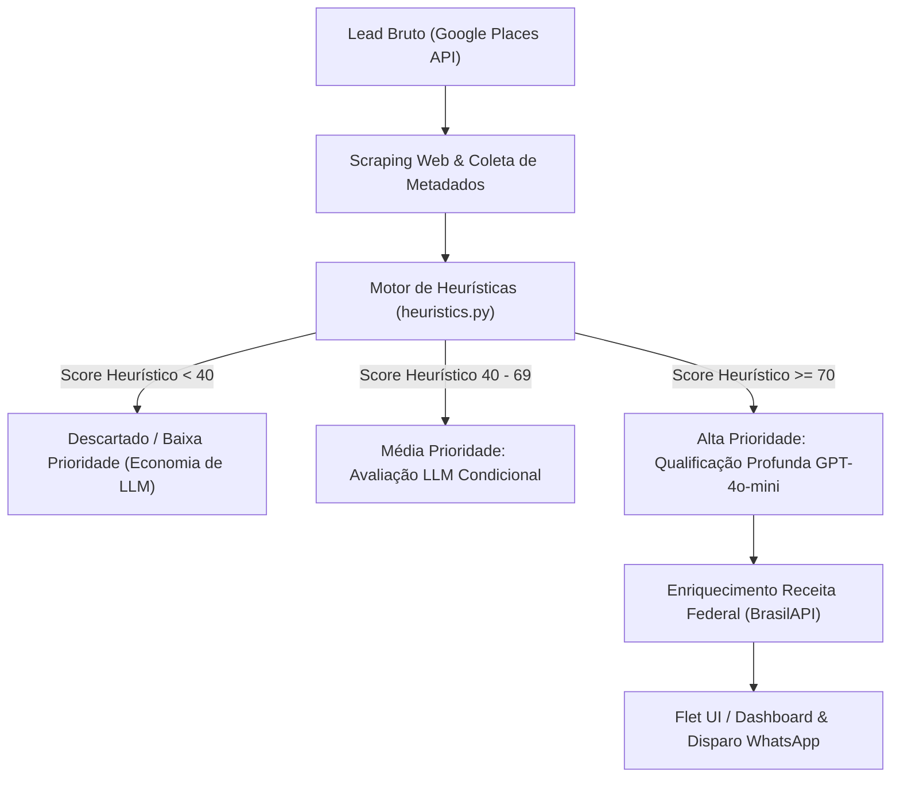

# Heurísticas de Detecção de PDV/ERP — ProspectAI

> Documento técnico de referência para detecção e qualificação heurística de sistemas de gestão (ERP), frente de caixa (PDV), cardápios digitais e plataformas de agendamento em empresas brasileiras.

---

## 1. Introdução

A prospecção ativa de pequenas e médias empresas (PMEs) no Brasil para venda de softwares de automação comercial, PDV (Ponto de Venda) e ERP enfrenta um desafio econômico e operacional: **o custo e a latência de processamento em larga escala**. 

Ao minerar milhares de estabelecimentos comerciais via Google Places API e raspagem web, submeter o conteúdo bruto de cada website ou perfil social diretamente a um Grande Modelo de Linguagem (LLM como o GPT-4o-mini) torna o pipeline:
1. **Onipresente e financeiramente proibitivo**: Análise via LLM em dezenas de milhares de páginas não filtradas gera custos desnecessários com tokens de entrada.
2. **Lento para alto throughput**: Requisições síncronas de IA aumentam a latência média por lead para 2 a 5 segundos, enquanto checagens heurísticas em memória e expressões regulares executam em menos de 10 milissegundos.
3. **Suscetível a alucinações de contexto raso**: Sem extração estruturada de evidências concretas (presença de scripts, links de checkout, formatos de pagamento), a LLM pode inferir erroneamente a maturidade digital do estabelecimento.

O **ProspectAI** emprega uma **arquitetura de funil em camadas**:



O motor heurístico atua como um classificador determinístico de alta performance. Ele analisa o DOM HTML, metadados de rede, perfis sociais, reviews públicas e dados cadastrais da empresa, atribuindo uma pontuação de propensão (`0` a `100`). Quanto maior a pontuação, maior a certeza de que a empresa **opera em processos manuais e necessita urgentemente de um PDV/ERP**.

---

## 2. Sinais de NÃO Possuir PDV/ERP (Sinais Positivos para Prospecção)

Estes sinais indicam baixa maturidade tecnológica, processos operacionais analógicos ou adoção de ferramentas improvisadas. No contexto do **ProspectAI**, são chamados de **sinais positivos**, pois qualificam o lead como um cliente potencial perfeito.

### 2.1. Cardápio ou Catálogo em PDF / Imagem
- **Descrição**: O estabelecimento disponibiliza seu catálogo ou cardápio por meio de arquivos estáticos em vez de uma aplicação web transacional.
- **Padrões de URL detectados**:
  - Arquivos diretos: `.pdf`, `.png`, `.jpg`, `.jpeg`, `.webp`
  - Links de armazenamento em nuvem: `drive.google.com`, `dropbox.com`, `onedrive.live.com`
  - Links de visualizadores estáticos: `canva.com/design/`, `issuu.com`, `heyzine.com`
  - Destaques no Instagram com fotos de cardápio impresso fotografado.
- **Interpretação**: A empresa não possui sistema que sincronize itens, estoque ou preços em tempo real. Qualquer alteração de preços exige republicação de arquivos.

### 2.2. Pedido Exclusivamente via WhatsApp "Cru"
- **Descrição**: O link de conversão aponta diretamente para o protocolo `wa.me/` ou `api.whatsapp.com/send` sem parâmetros de payload estruturado, carrinho de compras ou token de sessão.
- **Padrão de URL**:
  - `https://wa.me/55DDDNUMERO`
  - `https://api.whatsapp.com/send?phone=55DDDNUMERO&text=Ol%C3%A1`
- **Contraste com sistemas modernos**: Sistemas como *Anota AI* ou *Goomer* utilizam links intermediários com carrinho (`pedido.anota.ai/...` ou `cardapio.goomer.com.br/...`) ou mandam mensagens formatadas contendo ID de pedido, array de itens e forma de entrega.
- **Interpretação**: O atendente digita e calcula manualmente os totais no papel ou na calculadora do balcão.

### 2.3. Ausência de Agendamento Automatizado (Serviços e Clínicas)
- **Descrição**: Salões de beleza, barbearias, clínicas estéticas e consultórios médicos que instruem o cliente com frases como: *"Agendamentos via WhatsApp"*, *"Chame no direct para agendar"* ou *"Consulte horários disponíveis pelo chat"*.
- **Padrões no DOM**:
  - Expressões como `agende pelo whatsapp`, `marcar horário pelo direct`, `agenda via dm`, `consulte disponibilidade`.
  - Ausência de widgets de plataformas como *Trinks*, *Avec*, *AppBarber*, *Doctoralia* ou *Booksy*.
- **Interpretação**: A agenda é mantida em caderno de papel, Google Agenda pessoal ou planilha manual, gerando conflitos de horários, faltas (*no-shows*) e tempo excessivo gasto com triagem manual.

### 2.4. Chave Pix Pessoal (CPF, E-mail Pessoal ou Celular)
- **Descrição**: O método de cobrança rápida divulgado no site, rede social ou mensagem automática é uma chave Pix não vinculada a CNPJ.
- **Padrões regex de captura**:
  - CPF: `\b\d{3}\.?\d{3}\.?\d{3}-?\d{2}\b` (especialmente se o nome associado for uma pessoa física)
  - E-mails pessoais: `@gmail.com`, `@hotmail.com`, `@outlook.com`, `@yahoo.com.br`
  - Telefones celulares soltos como chave Pix.
- **Interpretação**: A empresa não utiliza conta bancária jurídica com conciliação automática via API bancária de ERP ou maquininha com Pix integrado via QR Code dinâmico. A conferência do comprovante é visual e manual.

### 2.5. Presença Digital em Plataformas Gratuitas Básicas sem E-commerce
- **Descrição**: O site está hospedado em serviços gratuitos de página única ou agregadores de links sem capacidades transacionais de retaguarda.
- **Padrões de domínio/HTML**:
  - `sites.google.com/*`
  - `*.wixsite.com/*` (versão gratuita exibindo banner superior oficial da Wix)
  - `*.blogspot.com` / `*.wordpress.com`
  - `*.canva.site`
  - `linktr.ee/*`, `beacons.ai/*`, `instabio.cc/*` contendo apenas links sociais e WhatsApp.
- **Interpretação**: Negócio em estágio de subsistência ou fase inicial, com orçamento restrito ou sem orientação tecnológica para adquirir software corporativo.

### 2.6. Ausência Total de Website Próprio
- **Descrição**: O estabelecimento possui cadastro no Google Meu Negócio, mas o campo `websiteUri` é nulo ou aponta diretamente para o Instagram, Facebook ou link direto do WhatsApp.
- **Interpretação**: Dependência exclusiva de redes sociais para tráfego e ausência completa de infraestrutura digital própria.

### 2.7. Menções a Processos Manuais em Avaliações do Google (Reviews)
- **Descrição**: Clientes relatam explicitamente o uso de comandas físicas ou blocos de notas.
- **Padrões textuais**: *"anotou no papel"*, *"comanda de papel"*, *"perderam o papelzinho"*, *"rasuraram a nota"*, *"sem sistema"*, *"sistema caiu e não sabiam cobrar"*.
- **Interpretação**: Evidência irrefutável de ausência de PDV ou uso de sistema legado instável.

### 2.8. Fricção no Caixa ou Atendimento em Reviews
- **Descrição**: Reclamações frequentes sobre o gargalo no pagamento e conferência de contas.
- **Padrões textuais**: *"fila imensa no caixa"*, *"demora para fechar a conta"*, *"troco errado"*, *"não sabiam quanto deu"*, *"demora para passar o cartão"*.
- **Interpretação**: Falta de automação de pré-fechamento de conta e falta de terminal de pagamento conectado diretamente ao ERP.

### 2.9. Registro Fotográfico de Balcão e Operação
- **Descrição**: Fotos postadas por usuários ou proprietários no Google Maps que exibem o balcão.
- **Elementos visuais (analisáveis via metadados/tags ou visão computacional futura)**:
  - Caderno espiral sobre o balcão de vendas.
  - Calculadora de mesa antiga junto a uma maquininha autônoma simples.
  - Ausência de monitor touch, terminal POS dedicado ou impressora térmica não fiscal (tipo Epson TM-T20 ou Bematech MP-4200).

### 2.10. Dados Cadastrais: MEI ou ME Recente com Capital Social Baixo
- **Descrição**: Dados obtidos via Receita Federal apontando constituição recente (< 2 anos), porte MEI (Microempreendedor Individual) ou ME com capital social inferior a R$ 20.000,00.
- **Interpretação**: Empresas nessa faixa muitas vezes começam sem software e logo chegam ao ponto de estrangulamento operacional quando o faturamento se aproxima do limite fiscal, tornando-se alvos perfeitos para ofertas de entrada.

---

## 3. Sinais de JÁ Possuir PDV/ERP (Sinais Negativos — Despriorizar)

Quando identificamos evidências sólidas de que o estabelecimento já opera com plataformas estabelecidas de mercado, o lead deve ser despriorizado ou receber pontuação muito baixa. Isso evita ligações improdutivas ou abordagens descontextualizadas para empresas com fidelidade contratual a players consolidados.

Abaixo está o catálogo com mais de **50 plataformas líderes no ecossistema brasileiro**, agrupadas por categoria, com seus respectivos padrões de detecção em DOM, URLs e scripts:

| # | Nome da Plataforma | Categoria | Domínios / Padrões de URL / Footprints HTML / Scripts | Descrição do Sinal Detectado |
|---|-------------------|-----------|-------------------------------------------------------|------------------------------|
| 1 | **Linx** | PDV / Frente de Caixa | `linx.com.br`, `linxpay`, `linxcommerce`, `microvix`, `dcg.com.br` | Presença de scripts Linx, checkout Microvix ou Linx Omnichannel |
| 2 | **Totvs (Fly01, Protheus)** | PDV / ERP | `totvs.com.br`, `protheus`, `fly01`, `totvspdv`, `bematech` | Scripts de integração Totvs, portais de clientes B2B |
| 3 | **Alterdata (Bimer/Pack)** | PDV / ERP | `alterdata.com.br`, `passaporte.alterdata`, `shop.alterdata` | Tags ou selos Alterdata Automação Comercial |
| 4 | **Korp** | ERP Industrial / Comercial | `korp.com.br`, `erpkorp` | Portais e autenticações Korp |
| 5 | **Senior Sistemas** | ERP / Gestão | `senior.com.br`, `rubi`, `sapiens` | Scripts Senior Sapiens / Plataforma Senior X |
| 6 | **NCR Brasil (Aloha)** | PDV Restaurantes | `ncr.com`, `aloha`, `ncraloha.com.br` | Sistemas POS avançados para franquias e redes |
| 7 | **ConnectPlug** | PDV Nuvem / Bar / Food | `connectplug.com.br`, `cplug.com.br` | Painel web de cardápio ou autoatendimento ConnectPlug |
| 8 | **Hiper (Linx)** | PDV / Varejo Pequeno | `hipersistemas.com.br`, `app.hiper.com.br` | Selos de loja integrada ou portal Hiper Loja |
| 9 | **KCMS** | PDV / Varejo / Food | `kcms.com.br`, `pedir.delivery`, `kcmscloud` | Cardápio web KCMS ou script de gestão na nuvem |
| 10 | **Elgin (ElginPDV)** | PDV / Hardware & Soft | `elgin.com.br`, `elginpdv` | Drivers web ou páginas de suporte de automação Elgin |
| 11 | **Bematech (Totvs)** | PDV Tradicional | `bematech.com.br`, `bemafi32`, `totvsbematech` | Menções técnicas ou portais fiscais vinculados |
| 12 | **Bling!** | ERP Nuvem / E-commerce | `bling.com.br`, `bling.com.br/api`, `bling.com.br/b/` | Tags de rastreio de checkout integrados ao Bling |
| 13 | **Tiny ERP (Olist)** | ERP Nuvem / E-commerce | `tiny.com.br`, `tinyerp` | Webhooks, links de catálogo integrado Tiny |
| 14 | **Omie** | ERP Gestão PME | `omie.com.br`, `omie.com.br/api`, `omiebox` | Portais financeiros ou boletos gerados via link Omie |
| 15 | **ContaAzul** | ERP Gestão Pequena Empresa | `contaazul.com`, `ca-api`, `app.contaazul.com` | Links de cobrança direta ou botões integrados |
| 16 | **Sankhya** | ERP Médias e Grandes | `sankhya.com.br`, `mge`, `sankhyaw` | Portal corporativo Sankhya-W |
| 17 | **SAP Business One** | ERP Corporativo | `sap.com`, `b1`, `sapb1` | Portais B2B ou endpoints corporativos |
| 18 | **Ciss (CissPoder)** | ERP Supermercados | `ciss.com.br`, `cisspoder` | Plataforma de autoatendimento ou e-commerce Ciss |
| 19 | **Market Software** | ERP Supermercados | `market.com.br`, `marketgestor` | Módulos web de cotação e compras |
| 20 | **Bluesoft** | ERP Varejo Nuvem | `bluesoft.com.br`, `bluesoftcosmos` | Módulos fiscais ou portal Cosmos |
| 21 | **Anota AI** | Delivery Automatizado | `anota.ai`, `pedido.anota.ai`, `app.anota.ai` | Atendimento bot WhatsApp e cardápio digital Anota AI |
| 22 | **Goomer** | Cardápio Digital / QR | `goomer.com.br`, `goomer.app`, `cardapio.goomer.com.br` | QR Code de mesa ou link de delivery Goomer Na Loja |
| 23 | **Saipos** | Gestão para Restaurantes | `saipos.com`, `saipos.com.br`, `saipos-delivery` | Integrações Saipos de gestão e impressão de comandas |
| 24 | **Cardápio Web** | Delivery Nuvem | `cardapioweb.com`, `cardapioweb.com.br` | Plataforma de pedidos com cálculo e pagamento |
| 25 | **OlaClick** | Cardápio Digital Nuvem | `olaclick.com`, `menu.olaclick.com` | Cardápio digital com integração WhatsApp |
| 26 | **Delivery Direto** | App e Cardápio Próprio | `deliverydireto.com.br` | Solução White-label com checkout próprio |
| 27 | **InstaDelivery** | Cardápio e Gestão Food | `instadelivery.com.br` | Links de loja `instadelivery.com.br/nome_loja` |
| 28 | **Programa Consumer** | PDV / Food / Connect | `programaconsumer.com.br`, `pedir.vc`, `consumerconnect` | Link de pedido do Consumer Connect ou comanda mobile |
| 29 | **Tagme** | Cardápio QR Code / Reserva | `tagme.com.br`, `tagmenu.com.br`, `reservas.tagme` | Menus interativos para alta gastronomia e reservas |
| 30 | **Hubster** | Agregador Delivery | `hubster.com`, `deliverect` | Módulos de consolidação iFood/Rappi/UberEats |
| 31 | **Rappi** | Marketplace Delivery | `rappi.com.br`, `restaurantes.rappi` | Links institucionais integrados a marketplace |
| 32 | **iFood (Loja Direta / Entrega)** | Marketplace Delivery | `ifood.com.br/delivery/`, `cardapio.ifood.com.br` | Link direto para loja no iFood com entrega própria ou parceira |
| 33 | **Neemo / Apper** | Delivery Próprio | `neemo.com.br`, `deliveryapp.neemo.com.br` | Plataforma de pedidos online integrada a múltiplos PDVs |
| 34 | **WhatsMenu** | Cardápio WhatsApp | `whatsmenu.com.br`, `pedido.whatsmenu.com.br` | Catálogo estruturado com envio de pedido serializado |
| 35 | **Aiqfome** | Delivery Regional | `aiqfome.com`, `pedir.aiqfome.com` | Presença consolidada em rede de delivery |
| 36 | **Nuvemshop** | E-commerce / Varejo | `nuvemshop.com.br`, `tiendanube.com`, `cdn.nuvemshop` | Plataforma de e-commerce completa com gestão integrada |
| 37 | **Loja Integrada** | E-commerce | `lojaintegrada.com.br`, `cdn.vtex.com/lojaintegrada` | E-commerce com emissão de NF e integrações de estoque |
| 38 | **Tray** | E-commerce / Locaweb | `tray.com.br`, `commerce.tray.com.br` | Scripts de checkout e retaguarda Tray |
| 39 | **Shopify** | E-commerce Global | `shopify.com`, `cdn.shopify.com`, `myshopify.com` | Plataforma com PDV omnichannel (Shopify POS) |
| 40 | **WooCommerce** | E-commerce / WordPress | `woocommerce`, `wc-api`, `wp-content/plugins/woocommerce` | Loja virtual com controle de estoque no banco de dados |
| 41 | **VTEX** | E-commerce Enterprise | `vtex.com`, `vtexcommercestable`, `vteximg` | Ecossistema completo de checkout e OMS (Order Management) |
| 42 | **Magento (Adobe)** | E-commerce | `magento`, `mage/cookies.js`, `/skin/frontend/` | Plataforma corporativa de vendas |
| 43 | **Yampi** | Checkout Transparente | `yampi.com.br`, `seguro.yampi.com.br` | Checkout de alta conversão integrado a ERPs |
| 44 | **Trinks** | Agendamento / Salão | `trinks.com`, `app.trinks.com`, `widget.trinks` | Sistema de agendamento online, comanda e faturamento |
| 45 | **Avec (BelezaSoft)** | Gestão de Beleza | `avec.com.br`, `avecbrasil`, `app.avec` | ERP, app de agendamento e split de pagamentos |
| 46 | **AppBarber / AppBeautician** | Agendamento / Barbearia | `appbarber.com.br`, `appbeautician.com.br` | Gestão de comissões, agendamento e frente de caixa |
| 47 | **Simples Agenda** | Agendamento / Finanças | `simplesagenda.com.br`, `sistema.simplesagenda` | Gestão online com emissão de carnês e notas fiscais |
| 48 | **Doctoralia** | Agendamento Saúde | `doctoralia.com.br`, `docplanner-platform` | Agenda médica integrada e telemedicina |
| 49 | **Booksy** | Agendamento Pessoal | `booksy.com`, `booksy.net` | Agendamento automatizado com pagamento no app |
| 50 | **Stone (Linx / Ton)** | Pagamento & PDV Integrado | `stone.com.br`, `ton.com.br`, `pos.stone.com.br` | Solução de pagamento com TEF ou checkout com integração Linx |
| 51 | **Cielo (Cielo LIO)** | PDV Smart | `cielo.com.br/lio`, `cielolio` | Máquina Smart com aplicativos de frente de caixa instalados |
| 52 | **PagSeguro (PagVendas)** | PDV / Gestão Micro | `pagseguro.uol.com.br/pagvendas`, `pagseguro.com.br` | Solução PagVendas com controle de estoque e comandas |
| 53 | **Mercado Pago (Point Smart)** | Gestão de Vendas | `mercadopago.com.br/point`, `mercadopago.com` | Integração de catálogo e faturamento via Point Smart |

---

## 4. Algoritmo de Pontuação Heurística (0 a 100)

O algoritmo do **ProspectAI** combina pesos ponderados de sinais positivos (carência de sistema) com reduções severas de penalização em caso de detecção de sistemas existentes.

### 4.1. Tabela de Pesos e Penalidades

| Código | Sinal Detectado | Tipo | Peso / Impacto | Justificativa |
|---|---|---|---|---|
| `SIG_CARDAPIO_PDF` | Link de cardápio/catálogo em PDF ou imagem estática | Positivo | **+25 pontos** | Forte indicador de ausência de catálogo dinâmico ou PDV. |
| `SIG_WHATSAPP_CRU` | Link para WhatsApp sem carrinho estruturado nem payload | Positivo | **+20 pontos** | Operação manual de recepção de pedidos no chat. |
| `SIG_SEM_WEBSITE` | Não possui site próprio (apenas Google Meu Negócio / redes) | Positivo | **+15 pontos** | Empresa com barreira de investimento digital. |
| `SIG_SITE_GRATUITO` | Site em construtor gratuito (Google Sites, Wix free, Canva) | Positivo | **+15 pontos** | Ausência de orçamento ou maturidade para infraestrutura. |
| `SIG_PIX_PESSOAL` | Chave Pix identificada como CPF ou e-mail pessoal | Positivo | **+15 pontos** | Falta de conta PJ com conciliação ou gateway de pagamento. |
| `SIG_REVIEW_PAPEL` | Review mencionando papel, bloco ou comanda manual | Positivo | **+25 pontos** | Prova empírica de processo arcaico de atendimento. |
| `SIG_REVIEW_DEMORA` | Review mencionando lentidão no caixa, fila ou troco | Positivo | **+10 pontos** | Fricção operacional de fechamento e cobrança. |
| `SIG_PORTE_MEI` | Empresa registrada como MEI na Receita Federal | Positivo | **+10 pontos** | Alta probabilidade de controle financeiro incipiente. |
| `SIG_IDADE_NOVA` | Empresa aberta há menos de 18 meses | Positivo | **+10 pontos** | Fase de estruturação; ainda não cristalizou um software. |
| `SIG_SEM_AGENDAMENTO`| Negócio de estética/saúde com agendamento apenas via DM | Positivo | **+20 pontos** | Descontrole de escala e perda de clientes por agendamento lento. |
| `PEN_PLATAFORMA_PDV` | Detecção de PDV/ERP líder (Linx, Totvs, Bling, Omie, etc.) | Negativo | **-80 pontos** | Empresa já fidelizada e atendida por sistema maduro. |
| `PEN_CARDAPIO_DIG` | Plataforma de delivery ativo (Anota AI, Goomer, Saipos, etc.)| Negativo | **-60 pontos** | Já superou o pedido em texto puro; processo automatizado. |
| `PEN_ECOMMERCE_FULL` | E-commerce estabelecido (Shopify, VTEX, Nuvemshop) | Negativo | **-70 pontos** | Já opera com retaguarda sincronizada de estoque. |
| `PEN_AGENDAMENTO_APP`| Widget de agendamento online (Trinks, Avec, AppBarber) | Negativo | **-70 pontos** | Gestão de horários já informatizada. |
| `PEN_REVIEW_SISTEMA` | Review elogiando sistema rápido, totem ou app próprio | Negativo | **-40 pontos** | Empresa informatizada na percepção do cliente. |

### 4.2. Fórmula de Cálculo e Normalização

O cálculo é executado segundo a fórmula:

$$\text{RawScore} = \sum (\text{Pesos Positivos}) - \sum (\text{Penalidades Negativas})$$

$$\text{HeuristicScore} = \max(0, \min(100, \text{RawScore}))$$

### 4.3. Classificação e Próximos Passos no Pipeline

- **ALTA PRIORIDADE (`Score >= 70`)**:
  - *Status*: Lead altamente qualificado para aquisição de PDV/ERP.
  - *Ação*: Encaminhar imediatamente para qualificação semântica no `GPT-4o-mini`, gerar abordagem consultiva hiperpersonalizada e priorizar na fila do Flet App para contato via WhatsApp.
- **MÉDIA PRIORIDADE (`40 <= Score <= 69`)**:
  - *Status*: Sinais mistos ou evidências incompletas (ex.: tem site moderno, mas o pedido de delivery é 100% no WhatsApp cru sem comanda digital).
  - *Ação*: Enriquecer com reviews adicionais no Google Places Details v1 antes de acionar a LLM.
- **BAIXA PRIORIDADE (`Score < 40`)**:
  - *Status*: Empresa já informatizada com sistemas consolidados ou sem presença mínima.
  - *Ação*: Descartar ou arquivar como frio. **Nenhum token de OpenAI é gasto**.

### 4.4. Árvore de Decisão Heurística (Mermaid)

```mermaid
flowchart TD
    Start(["Início: Análise do Lead"]) --> CheckTech{"Detectou Software Concorrente no DOM?<br>(Linx, Totvs, Bling, Anota AI, Trinks...)"}
    
    CheckTech -- "SIM (Match na Tabela)" --> ApplyPen["Aplicar Penalidade Severa (-60 a -80 pts)"]
    ApplyPen --> FinalCalc["Calcular Score Final (Clamp 0..100)"]
    
    CheckTech -- "NÃO" --> CheckSite{"Possui Website Próprio?"}
    
    CheckSite -- "NÃO (Apenas Maps/Redes)" --> AddNoSite["Adicionar +15 pts (Sem Presença Própria)"]
    CheckSite -- "SIM" --> ScanDOM["Escanear DOM do Site (Links, Scripts, Textos)"]
    
    AddNoSite --> CheckReviews
    ScanDOM --> CheckMenu{"Cardápio/Catálogo em PDF, Imagem ou Drive?"}
    CheckMenu -- "SIM" --> AddPDF["Adicionar +25 pts"]
    CheckMenu -- "NÃO" --> CheckWA
    AddPDF --> CheckWA{"Link de WhatsApp é 'Cru' (sem carrinho)?"}
    
    CheckWA -- "SIM" --> AddWA["Adicionar +20 pts"]
    CheckWA -- "NÃO" --> CheckFreePlatform
    AddWA --> CheckFreePlatform{"Site em Plataforma Básica (Google Sites/Wix/Canva)?"}
    
    CheckFreePlatform -- "SIM" --> AddFree["Adicionar +15 pts"]
    CheckFreePlatform -- "NÃO" --> CheckPix
    AddFree --> CheckPix{"Chave Pix é CPF ou E-mail Pessoal?"}
    
    CheckPix -- "SIM" --> AddPix["Adicionar +15 pts"]
    CheckPix -- "NÃO" --> CheckReviews
    AddPix --> CheckReviews{"Existem Reviews Públicas no Google Maps?"}
    
    CheckReviews -- "SIM" --> ScanKeywords["Escanear Palavras-Chave de Fricção/Processo Manual"]
    ScanKeywords --> ReviewScoreMod["Modificar Score: +25 (papel/bloquinho) ou -40 (app/totem)"]
    CheckReviews -- "NÃO" --> CheckReceita
    ReviewScoreMod --> CheckReceita{"Dados de CNPJ Disponíveis?"}
    
    CheckReceita -- "SIM" --> CheckPorte{"Porte MEI ou Idade < 2 anos?"}
    CheckPorte -- "SIM" --> AddMEI["Adicionar +10 a +20 pts"]
    CheckPorte -- "NÃO" --> FinalCalc
    AddMEI --> FinalCalc
    CheckReceita -- "NÃO" --> FinalCalc
    
    FinalCalc --> EvalScore{"Pontuação Final"}
    EvalScore -- ">= 70" --> High["ALTA PRIORIDADE -> Disparar GPT-4o-mini & Flet"]
    EvalScore -- "40 a 69" --> Med["MÉDIA PRIORIDADE -> Enriquecimento Adicional"]
    EvalScore -- "< 40" --> Low["BAIXA PRIORIDADE -> Descarte Imediato (0 Custo LLM)"]
```



---

## 5. Análise Semântica de Google Reviews

As avaliações públicas do Google Meu Negócio oferecem um vislumbre autêntico do chão de loja do estabelecimento comercial. Enquanto o website corporativo pode tentar aparentar modernidade, a experiência do cliente final desvenda as falhas operacionais e a precariedade dos processos.

### 5.1. Dicionário de Palavras-Chave e Padrões Regex

O módulo de processamento de texto varre o array de `reviews` retornado pelo endpoint de *Place Details (New)* da Google Places API, segmentando comentários por polaridade técnica:

#### A. Palavras-Chave Positivas para Prospecção (Indícios de Processo Manual e Fricção)

Estas expressões indicam que o cliente sofreu com a falta de tecnologia de gestão:

```python
KEYWORDS_POSITIVAS_PROSPECCAO = [
    # Processos manuais explícitos
    r"\banot(ou|ado|am)\s+no\s+papel\b",
    r"\bcomanda\s+de\s+papel\b",
    r"\bbloquinho\b",
    r"\bcomanda\s+manual\b",
    r"\bsem\s+sistema\b",
    r"\bsistema\s+caiu\b",
    r"\bn(ã|a)o\s+tinha\s+sistema\b",
    r"\banotad(o|a)\s+(à|a)\s+m(ã|a)o\b",
    r"\bperderam\s+(o\s+pedido|a\s+comanda|minha\s+comanda)\b",
    r"\bmarcaram\s+duas\s+vezes\s+o\s+mesmo\s+hor(á|a)rio\b",
    r"\bconfundiram\s+(os\s+pedidos|as\s+mesas)\b",
    
    # Fricção no checkout / caixa
    r"\bfila\s+enorme\s+no\s+caixa\b",
    r"\bdemora\s+absurda\s+para\s+pagar\b",
    r"\bdemor(ou|am)\s+para\s+(trazer|fechar)\s+a\s+conta\b",
    r"\bn(ã|a)o\s+tinham\s+troco\b",
    r"\bconta\s+errada\b",
    r"\bcobraram\s+a\s+mais\b",
    r"\bcaixa\s+lento\b",
    r"\bmaquininha\s+(n(ã|a)o\s+pegava|sem\s+sinal|lenta)\b",
    r"\bdesorganiza(ç|c)(ã|a)o\s+no\s+atendimento\b"
]
```

#### B. Palavras-Chave Negativas para Prospecção (Indícios de Modernização Concorrente)

Se os clientes elogiam ferramentas digitais, o estabelecimento provavelmente já investiu em soluções tecnológicas:

```python
KEYWORDS_NEGATIVAS_PROSPECCAO = [
    r"\bcard(á|a)pio\s+digital\b",
    r"\bpedi(do|mos)\s+pelo\s+(tablet|celular|qrcode|qr\s+code)\b",
    r"\btotem\s+de\s+autoatendimento\b",
    r"\baplicativo\s+pr(ó|o)prio\b",
    r"\bsistema\s+muito\s+r(á|a)pido\b",
    r"\bpainel\s+eletr(ô|o)nico\b",
    r"\bfechamento\s+autom(á|a)tico\b",
    r"\bpedi\s+pelo\s+ifood\b",
    r"\bapp\s+super\s+f(á|a)cil\b"
]
```

### 5.2. Mecanismo de Análise de Sentimento com Contexto Negativo

Não basta encontrar a palavra *"sistema"*, pois uma avaliação dizendo *"o sistema deles é excelente"* tem conotação oposta a *"o sistema deles não funciona e anotam no papel"*.

O algoritmo adota uma janela de contexto de 5 palavras antes e depois do termo-chave para verificar negações (`não`, `nunca`, `sem`, `péssimo`, `lento`):

```python
# heuristics_example.py
import re
from typing import List, Dict, Any

class ReviewAnalyzer:
    def __init__(self):
        self.positive_patterns = [re.compile(p, re.IGNORECASE) for p in KEYWORDS_POSITIVAS_PROSPECCAO]
        self.negative_patterns = [re.compile(p, re.IGNORECASE) for p in KEYWORDS_NEGATIVAS_PROSPECCAO]

    def analyze_reviews(self, reviews: List[Dict[str, Any]]) -> Dict[str, Any]:
        """
        Analisa lista de avaliações do Google Places API (New).
        Retorna pontuação de ajuste e evidências textuais encontradas.
        """
        score_delta = 0
        evidences = []

        for review in reviews:
            text = review.get("text", {}).get("text", "")
            if not text:
                continue

            # Checar sinais positivos (operacao manual / dor)
            for pattern in self.positive_patterns:
                match = pattern.search(text)
                if match:
                    score_delta += 25
                    evidences.append({
                        "tipo": "DOR_DETECTADA",
                        "termo": match.group(0),
                        "trecho": text[max(0, match.start() - 30):min(len(text), match.end() + 30)].strip(),
                        "autor": review.get("authorAttribution", {}).get("displayName", "Cliente")
                    })
                    break  # Evitar múltiplas pontuações da mesma review

            # Checar sinais negativos (ja modernizado)
            for pattern in self.negative_patterns:
                match = pattern.search(text)
                if match:
                    score_delta -= 30
                    evidences.append({
                        "tipo": "MODERNIDADE_CONCORRENTE",
                        "termo": match.group(0),
                        "trecho": text[max(0, match.start() - 30):min(len(text), match.end() + 30)].strip(),
                        "autor": review.get("authorAttribution", {}).get("displayName", "Cliente")
                    })
                    break

        return {
            "score_delta": score_delta,
            "evidences": evidences
        }
```

---

## 6. Exemplo de Implementação do Motor de Heurísticas

Abaixo, a estrutura completa do módulo avaliador [`HeuristicEngine`](file:///c:/Users/PICHAU/Documents/agente_ia/docs/heuristics.md) com tipagem Python 3.12+, pronto para integração com o restante do pipeline do **ProspectAI**:

```python
# core/heuristics.py
from dataclasses import dataclass, field
import re
from typing import List, Dict, Optional, Any
from urllib.parse import urlparse

@dataclass
class LeadEvaluation:
    business_name: str
    heuristic_score: int
    classification: str  # 'ALTA', 'MEDIA', 'BAIXA'
    detected_signals: List[str] = field(default_factory=list)
    competitors_found: List[str] = field(default_factory=list)
    pain_points: List[str] = field(default_factory=list)

class HeuristicEngine:
    def __init__(self):
        # Tabela de assinaturas de concorrentes (domínios e padrões)
        self.competitor_signatures = {
            "Linx": ["linx.com.br", "linxpay", "microvix"],
            "Totvs": ["totvs.com.br", "fly01", "bematech.com.br"],
            "Bling": ["bling.com.br"],
            "Tiny ERP": ["tiny.com.br"],
            "Omie": ["omie.com.br"],
            "ContaAzul": ["contaazul.com"],
            "Anota AI": ["anota.ai", "pedido.anota.ai"],
            "Goomer": ["goomer.com.br", "goomer.app"],
            "Saipos": ["saipos.com"],
            "Trinks": ["trinks.com"],
            "Avec": ["avec.com.br"],
            "AppBarber": ["appbarber.com.br"],
            "Nuvemshop": ["nuvemshop.com.br", "tiendanube.com"],
            "Shopify": ["shopify.com", "myshopify.com"],
            "WooCommerce": ["woocommerce", "wp-content/plugins/woocommerce"],
            "Consumer": ["programaconsumer.com.br", "pedir.vc"]
        }
        self.review_analyzer = ReviewAnalyzer()

    def evaluate(
        self,
        name: str,
        website_url: Optional[str],
        html_content: Optional[str],
        whatsapp_urls: List[str],
        reviews: List[Dict[str, Any]],
        cnpj_data: Optional[Dict[str, Any]] = None
    ) -> LeadEvaluation:
        score = 0
        detected_signals = []
        competitors = []
        pain_points = []

        # 1. Checagem de Concorrentes no HTML e URLs
        full_text_to_scan = (html_content or "") + " " + (website_url or "")
        for comp_name, patterns in self.competitor_signatures.items():
            for pat in patterns:
                if pat.lower() in full_text_to_scan.lower():
                    competitors.append(comp_name)
                    break

        if competitors:
            score -= 75
            detected_signals.append(f"PENALIDADE: Concorrentes detectados: {', '.join(competitors)}")

        # 2. Análise de Presença Web
        if not website_url or any(dom in website_url for dom in ["instagram.com", "facebook.com", "wa.me"]):
            score += 15
            detected_signals.append("SIG_SEM_WEBSITE: Sem website próprio dedicado (+15)")
        else:
            # Plataformas Gratuitas
            if any(free in website_url.lower() for free in ["sites.google.com", "wixsite.com", "blogspot.com", "canva.site"]):
                score += 15
                detected_signals.append("SIG_SITE_GRATUITO: Hospedagem básica gratuita (+15)")

        # 3. Análise de Cardápio / Catálogo em PDF ou Nuvem Estática
        if html_content:
            pdf_pattern = re.compile(r'href=[\'"][^\'"]*(\.pdf|drive\.google\.com|dropbox\.com)[^\'"]*[\'"]', re.I)
            if pdf_pattern.search(html_content):
                score += 25
                detected_signals.append("SIG_CARDAPIO_PDF: Catálogo ou cardápio em PDF/Nuvem estática (+25)")

            # Chave Pix CPF ou Email no HTML
            pix_cpf_pattern = re.compile(r'\b\d{3}\.\d{3}\.\d{3}-\d{2}\b')
            pix_email_pattern = re.compile(r'\b[A-Za-z0-9._%+-]+@(gmail|hotmail|outlook|yahoo)\.com(\.br)?\b', re.I)
            if "pix" in html_content.lower() and (pix_cpf_pattern.search(html_content) or pix_email_pattern.search(html_content)):
                score += 15
                detected_signals.append("SIG_PIX_PESSOAL: Chave Pix informal (CPF ou email pessoal) (+15)")

        # 4. Análise de Links WhatsApp
        for wa in whatsapp_urls:
            # WhatsApp "Cru": sem parâmetros de catálogo/carrinho
            if "wa.me" in wa or "api.whatsapp.com" in wa:
                if "cardapio" not in wa.lower() and "pedido" not in wa.lower() and "cart" not in wa.lower():
                    score += 20
                    detected_signals.append("SIG_WHATSAPP_CRU: Atendimento manual via WhatsApp sem automação (+20)")
                    break

        # 5. Análise de Avaliações do Google
        review_analysis = self.review_analyzer.analyze_reviews(reviews)
        score += review_analysis["score_delta"]
        for ev in review_analysis["evidences"]:
            if ev["tipo"] == "DOR_DETECTADA":
                pain_points.append(f"{ev['autor']}: \"{ev['trecho']}\"")
                detected_signals.append(f"SIG_REVIEW_DOR: {ev['termo']} (+25)")
            else:
                detected_signals.append(f"PEN_REVIEW_SISTEMA: {ev['termo']} (-30)")

        # 6. Dados da Receita Federal (BrasilAPI)
        if cnpj_data:
            porte = cnpj_data.get("porte", "")
            if "MICRO EMPRESA" in porte or "MEI" in porte:
                score += 10
                detected_signals.append(f"SIG_PORTE_{porte}: Porte compatível com PME (+10)")

        # Normalização final
        final_score = max(0, min(100, score))

        classification = "BAIXA"
        if final_score >= 70:
            classification = "ALTA"
        elif final_score >= 40:
            classification = "MEDIA"

        return LeadEvaluation(
            business_name=name,
            heuristic_score=final_score,
            classification=classification,
            detected_signals=detected_signals,
            competitors_found=list(set(competitors)),
            pain_points=pain_points
        )
```

---

## 7. Boas Práticas e Recomendações de Manutenção

> [!TIP]
> **Atualização Contínua de Assinaturas de Concorrentes**: Novos cardápios digitais surgem frequentemente no mercado brasileiro. Recomenda-se auditar amostras mensais de leads descartados para identificar novos domínios emergentes no ecossistema food e varejista.

> [!IMPORTANT]
> **Respeito aos Limites e Cabeçalhos de Scraping**: Ao raspar os websites dos negócios, utilize sempre um User-Agent realista de navegador desktop (ex.: Chrome no Windows) e limites rígidos de timeout (máximo de 5 segundos) com `httpx`. Websites que não responderem em até 5 segundos devem ser pontuados com heurística de `SIG_SEM_WEBSITE` parcial sem travar o pipeline concorrente.

> [!NOTE]
> Para detalhes sobre como os dados de entrada deste motor são consumidos das APIs de Google Places, BrasilAPI e repassados ao `GPT-4o-mini`, consulte o documento complementar: [Integrações de API — ProspectAI](file:///c:/Users/PICHAU/Documents/agente_ia/docs/api_integrations.md).
